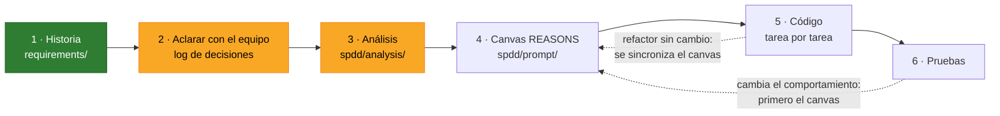
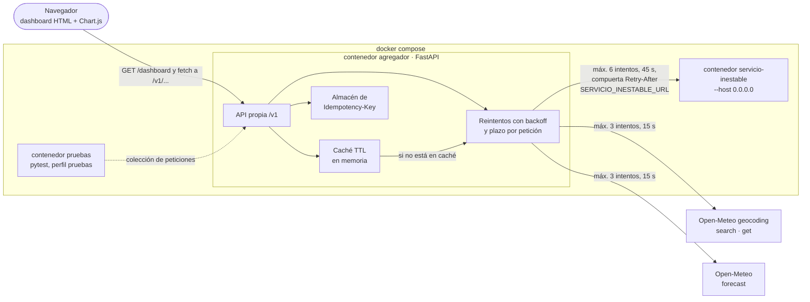
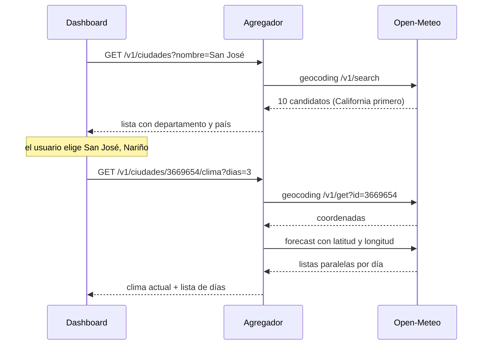
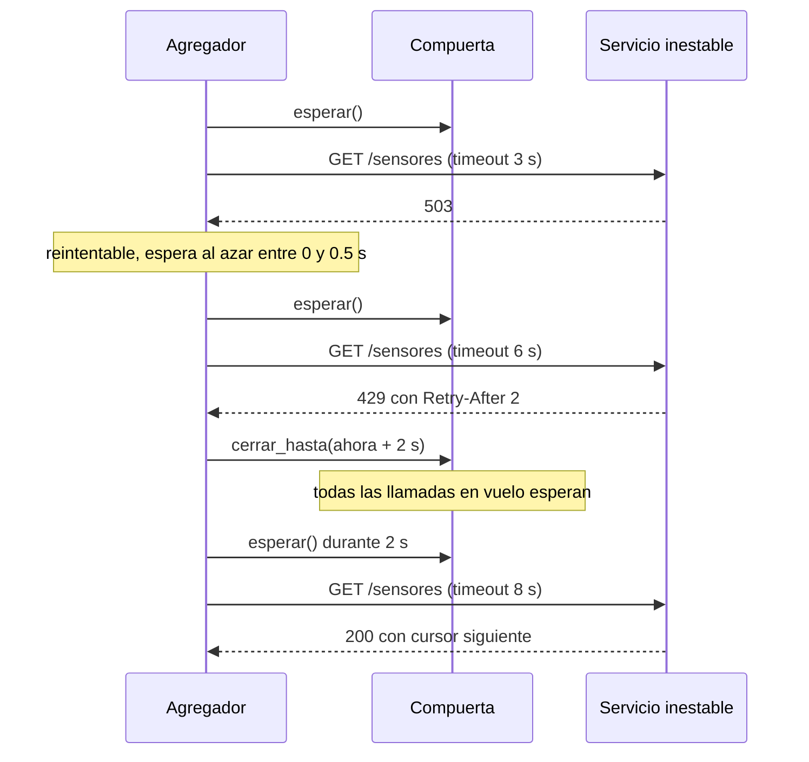

# Agregador resiliente de APIs

Parcial 2 de Sistemas Distribuidos (Escuela de Ingeniería de Sistemas e Informática,
UIS). Un servicio en FastAPI que consume **Open-Meteo** y un servicio de sensores que
falla a propósito, y expone una API propia que sigue respondiendo bien aunque sus
dependencias fallen. Encima va un dashboard.

El requerimiento se trabaja con **SPDD** (Structured Prompt-Driven Development): se
decide y se escribe la especificación antes de generar código, y cada decisión queda
registrada en este README.

## Estado

> **Fase actual: aclarar requerimientos (paso 2 de SPDD).** Hay 31 decisiones tomadas
> y 9 pendientes. **Todavía no hay código**: el equipo decidió cerrar las decisiones
> antes de desarrollar. Lo único ejecutable es `servicio_inestable.py`, del docente,
> y la simulación de reintentos del análisis.



Verde: terminado. Amarillo: en curso. El análisis ya tiene la exploración hecha, pero
falta que el equipo lo revise.

## Integrantes y roles

| Integrante | Código | Rol |
|---|---|---|
| Javier Alexi Chacón Suárez | 2160044 | Pendiente ([P01](#decisiones-pendientes)) |
| *(compañera, nombre por completar)* | | Pendiente ([P01](#decisiones-pendientes)) |

## Qué vamos a construir

Todo lo que se ejecute corre en contenedores Docker ([D16](#log-de-decisiones)): el
agregador, el servicio inestable, las pruebas y la medición de latencia. También con
el docente: no hay plan B fuera de Docker ([D23](#log-de-decisiones)).

API propia (todo bajo `/v1`, salvo la salud):

| Método y ruta | Qué hace | Dependencia |
|---|---|---|
| `GET /v1/ciudades?nombre=&pais=` | Candidatos de una búsqueda, con departamento y país | Open-Meteo geocoding `search` |
| `GET /v1/ciudades/{id}/clima?dias=` | Clima actual y pronóstico por día de la ciudad elegida | Open-Meteo geocoding `get` → `forecast` |
| `GET /v1/sensores` | Todos los sensores con su lectura, tolerando fallos | Servicio inestable (paginación + lecturas) |
| `POST /v1/alertas` | Crea una alerta de umbral (201 + `Location`); idempotente con `Idempotency-Key` obligatoria | Ninguna |
| `GET /v1/alertas` y `GET /v1/alertas/{id}` | Lista las alertas o trae una | Ninguna |
| `GET /salud` | Comprobación de vida del agregador | Ninguna |
| `GET /dashboard` | Dashboard estático (fase 2) | Nuestra propia API |



Cómo se encadenan las llamadas a Open-Meteo cuando el usuario busca una ciudad:



## Metodología: SPDD

SPDD es un método de Thoughtworks (publicado en el sitio de Martin Fowler en abril
de 2026) que trata los prompts como artefactos de ingeniería versionados junto al
código. El prompt estructurado se llama **canvas REASONS**:

| Letra | Sección | Pregunta que responde |
|---|---|---|
| R | Requirements | ¿Qué problema resolvemos y cuándo está terminado? |
| E | Entities | ¿Qué entidades hay y cómo se relacionan? |
| A | Approach | ¿Con qué estrategia lo resolvemos? |
| S | Structure | ¿Dónde encaja en el sistema? |
| O | Operations | ¿En qué pasos concretos y verificables se implementa? |
| N | Norms | ¿Qué convenciones aplican a todo? |
| S | Safeguards | ¿Qué no se puede romper nunca? |

Reglas que seguimos:

1. Primero la historia, después el análisis, después el canvas, y solo entonces el
   código, revisando en equipo entre cada paso.
2. **Cuando la realidad diverge, se corrige primero el canvas** y después el código.
   Un refactor que no cambia el comportamiento va al revés: código primero y luego se
   sincroniza el canvas.
3. SPDD no trae un log de decisiones propio. Lo agregamos aquí y cada decisión dice a
   qué sección del canvas alimenta, para que el canvas pueda citarla.

| Carpeta | Contenido |
|---|---|
| [`requirements/`](requirements/) | Historias y criterios de aceptación (paso 1) |
| [`spdd/analysis/`](spdd/analysis/) | Análisis: exploración de Open-Meteo y del servicio inestable (paso 3) |
| [`spdd/template/`](spdd/template/) | Plantilla del canvas REASONS |
| `spdd/prompt/` | Canvas REASONS (paso 4, siguiente) |

Los archivos siguen el patrón del artículo: `ID-AAAAMMDDhhmm-[Tipo]-descripcion.md`.

## Log de decisiones

D01–D16 se tomaron el 2026-10-17. La ronda 0 es lo que el equipo trajo decidido; de
la 1 a la 3 se iteró con el agente antes de escribir nada; la 4 la propuso el equipo
después de abrir el PR. La ronda 5 (2026-10-23) cerró los pendientes de resiliencia
con el apoyo de una simulación (sección 4 del [análisis](spdd/analysis/), hallazgos
M1–M6), y confirmó D07 y los supuestos S1–S3. La 6 la propuso el equipo después de
abrir el PR de la ronda 5. La 7, el mismo día, cerró la idempotencia y cómo se arma
Docker; lo de Docker se verificó con Compose antes de registrarlo (hallazgos C5–C7
del análisis).

| ID | Decisión | Alternativas descartadas | Por qué | REASONS | Ronda |
|---|---|---|---|---|---|
| D01 | API externa: **Open-Meteo** | Frankfurter, Nager.Date, PokeAPI, Open Library, datos.gov.co | Elección del equipo; permite encadenar geocodificación → pronóstico sin clave | R | 0 |
| D02 | Metodología **SPDD** con log de decisiones en este README | Desarrollo directo sin especificación | Elección del equipo; deja trazable por qué el código es como es | N | 0 |
| D03 | **Repo propio del grupo**; en el vault personal queda solo una nota con el enlace | Dentro del vault; vault ahora y repo después | Es trabajo en grupo y todos deben poder clonar y hacer push | S | 1 |
| D04 | Endpoints **separados** para clima y para sensores | Agregar un resumen de campus; un solo endpoint combinado | Cada parte se prueba y se explica sola; los fallos de un origen no contaminan al otro | S | 1 |
| D05 | Nombre ambiguo → **lista de candidatos con su país**, elegida en un buscador del dashboard | Tomar el primero con filtro de país; tomar solo el primero | «San José» da 10 resultados y el primero es California; el usuario debe ver y elegir | R | 1 |
| D06 | Log visualizado como **tabla + diagramas Mermaid** | Línea de tiempo; solo tabla | Se ve en GitHub y en Obsidian sin herramientas extra | N | 1 |
| D07 | Ciudades en dos endpoints: búsqueda `GET /v1/ciudades?nombre=&pais=` y clima por id `GET /v1/ciudades/{id}/clima` | `GET /v1/ciudades/{nombre}/clima` del catálogo | Derivada de D05: el id identifica una sola ciudad, y `get` + `forecast` son las dos llamadas distintas que exige el taller. *Propuesta en la ronda 2 sin objeciones y confirmada en la ronda 5.* | O | 2 |
| D08 | Dashboard en **HTML + JS (Chart.js)** servido por el mismo FastAPI | Streamlit; frontend aparte en React/Vite | Un solo proceso para el docente, sin CORS, dentro de las tecnologías del taller | S | 2 |
| D09 | **Backend primero** (partes A–D), dashboard después | En paralelo; dashboard desde el inicio | La rúbrica no da puntos por el dashboard; si falta tiempo, que falte lo que no suma | O | 2 |
| D10 | Dashboard con 4 vistas: **resiliencia, pronóstico, comparar ciudades, sensores y exterior vs interior** | Subconjuntos | El panel de resiliencia muestra en vivo lo que sí se califica; la relación exterior vs interior se arma en el dashboard llamando a los dos endpoints | R | 2 |
| D11 | Repo en `javierchacon262/agregador-resiliente`, **público** | Privado con colaboradores; organización del grupo | Elección del equipo. Riesgo aceptado: otros grupos pueden ver el código antes de la entrega | S | 2 |
| D12 | Reintentos **a mano**, con **cada función explicada en este log** ([detalle abajo](#d12-en-detalle-reintentos-función-por-función)) | tenacity; reintentos del transporte de httpx (solo reintentan errores de conexión, no 503 ni 429) | Es lo que más pesa en la evaluación (30 puntos) y cualquiera del grupo debe poder explicarlo | A | 3 |
| D13 | Timeout de lectura **adaptativo: 3 s → 5 s → 8 s** según el intento | 3 s fijo; 5–6 s fijo | El primer intento corta rápido las respuestas lentas y los siguientes toleran la latencia (4 s, o 5 s del docente). *Ajustada por D19 a 3 → 6 → 8 s: el de 5 s no toleraba los 5 s.* | A | 3 |
| D14 | Lecturas con **máximo 4 a la vez + compuerta compartida de Retry-After** | Secuencial; bajo demanda desde el navegador | El bloqueo por 429 es por IP: sin compuerta, las llamadas en vuelo aparecerían como «no respetó Retry-After» en el log del docente | A, S | 3 |
| D15 | Fallo parcial: **devolver siempre lo obtenido**, marcado como incompleto | Páginas todo o nada y lecturas parciales; todo o nada | Más disponibilidad para el dashboard. El caso sin datos (riesgo R1) lo cierra D21 | A | 3 |
| D16 | **Docker para todo lo que se ejecute**: agregador, servicio inestable, pruebas y medición de latencia | Solo `venv` local (lo que asumía el enunciado y lo que había recomendado el agente); Docker opcional | Según el equipo, la reproducibilidad y la desplegabilidad del prototipo son temas importantes de la evaluación. Cómo se arma queda en P16–P21. Ver el riesgo R4 | S, N | 4 |
| D17 | Máximo **6 intentos** por llamada al servicio inestable, configurable. Cierra P08 junto con D18 | 3 (la propuesta de P08), 4 y 5 | En la simulación, con 3 intentos solo sale completa el 8,9 % de las respuestas de `GET /v1/sensores` (0,9 % con los parámetros del enunciado); con 6, el 85 % (59 %), por unos 6 s más de mediana. Las páginas van en serie y una perdida se lleva las siguientes (M1, M2) | A | 5 |
| D18 | **Plazo por petición recibida**: 45 s en `/v1/sensores` y 15 s en los de Open-Meteo, configurables. Cada intento usa `mín(su timeout, lo que queda del plazo)` y no se duerme una espera que pase del plazo. Cierra P08 y R2 | 30 s; 20 s por cada llamada saliente (la propuesta de P08); sin plazo, solo intentos | Un plazo por llamada no acota la petición: 5 páginas en serie más las lecturas pasan del minuto. 45 s casi no baja la completitud frente a no tener plazo; 30 s la baja del 58 % al 39 % con el enunciado (M3) | A | 5 |
| D19 | Timeouts de lectura **3 → 6 → 8 s**. Modifica D13 | 3 → 5 → 8 s (D13 tal cual); 6 → 8 → 8 s, sin corte rápido | Con `--latencia 5` el timeout de 5 s también cortaba las lentas: 48 % de respuestas completas frente a 58 % (M4). Se mantiene el corte de 3 s del primer intento para que la evidencia muestre timeouts reintentados (M5) | A | 5 |
| D20 | **504** si el último intento terminó en timeout o se acabó el plazo; **502** si la dependencia respondió con error (503, 429 o error de conexión hasta agotar los intentos) o con datos que no cumplen el modelo. El cuerpo dice la dependencia, la causa y los intentos. Cierra P12 | 504 solo por timeout y 502 en lo demás (la propuesta de P12); siempre 502 | 504 es «la dependencia no respondió a tiempo», y un plazo agotado también lo es. Distinguir los dos le dice al cliente qué pasó, y la rúbrica califica los códigos de estado | R, A | 5 |
| D21 | `GET /v1/sensores` responde **502/504** (según D20) si no obtuvo ningún sensor **o ninguna lectura**; si hay al menos una lectura, 200 con `completo: false` y el motivo (D15). Cierra P09 y R1 | Solo cuando falta la primera página (lo que había recomendado el agente); 200 vacío con `completo: false` | Elección del equipo: una lista de sensores sin ningún valor se trata como fallo de la dependencia, no como resultado parcial. En la simulación pasa el 0,5 % de las veces (defecto) y el 1,9 % (enunciado) | R, A | 5 |
| D22 | **Reintentos también hacia Open-Meteo**, con la misma función y reglas, sin compuerta (no manda Retry-After, E10), máximo 3 intentos y plazo de 15 s. Los **errores de conexión** (conexión rechazada o cortada) se reintentan hacia las dos dependencias. Cierra P11 | Igual que sensores, con 6 intentos; solo errores de conexión y timeouts; no reintentar Open-Meteo | Un fallo pasajero de Open-Meteo no debería volverse un 502 si un segundo intento lo resuelve. Pero es estable y la IP de la sala es compartida (E13): si manda un 429, insistir 6 veces perjudica a todos | A | 5 |
| D23 | **Nada fuera de Docker**, tampoco con el docente: no hay plan B con `venv`. Cierra P20 y R4 | Plan B con `venv` documentado en el README (la propuesta de P20) | El docente confirmó que corre todo en Docker. Un plan B no cubriría ningún caso real y obligaría a mantener instrucciones duplicadas y a probar el código fuera del contenedor (S2) | S, N | 6 |
| D24 | Una alerta es un **umbral registrado**: objetivo (ciudad por id o sensor), variable, condición y umbral. `POST /v1/alertas` la crea (201 + `Location`), `GET /v1/alertas` las lista y `GET /v1/alertas/{id}` trae una (404 si no existe). Solo se guarda, no se evalúa, y vive en memoria: se pierde al reiniciar el contenedor. Cierra P06 | Umbral evaluado al consultar; solo el POST | El recurso sigue sin dependencias externas, así que la idempotencia se demuestra sin el ruido de los fallos. Un recurso que se crea y se puede leer es mejor diseño de API, y el 201 tiene a dónde apuntar con `Location` | R, E | 7 |
| D25 | `Idempotency-Key` **obligatoria**, según el borrador IETF: sin clave → 400; misma clave y mismo cuerpo → la respuesta guardada, sin crear otra alerta; misma clave con otro cuerpo → 422; misma clave con la primera en curso → 409. El cuerpo se compara por su huella (SHA-256 del JSON normalizado) y las claves duran 24 h en memoria. Cierra P07 | Clave opcional (como Stripe); mínima, solo repetir la respuesta | Una clave obligatoria deja claro en `/docs` qué garantiza la API. El 422 y el 409 cubren los errores reales de un cliente que reintenta: reutilizar una clave con otro cuerpo, o reintentar antes de que llegue la primera respuesta | R, A | 7 |
| D26 | Colección de pruebas en **pytest + httpx**, en la misma imagen que la medición de latencia. Cada prueba es una petición o una cadena, con un docstring que dice qué demuestra; contra el servicio inestable se afirman invariantes (200, 502 o 504; `completo` coherente), no resultados exactos. Cierra P22, un pendiente nuevo que salió de P16 y P21 en esta ronda | Hurl; Postman + newman | Un solo lenguaje y una sola imagen para las pruebas y la latencia (P04). El docente corre un comando y ve qué pasa y qué falla | O, N | 7 |
| D27 | **Sin CI**: se prueba a mano, con la colección (D26), antes de cada entrega. Cierra P21 | CI completa en cada PR (lo que había recomendado el agente); CI que solo construye y comprueba `/salud` | Elección del equipo. La reproducibilidad depende de esa prueba manual desde un clon limpio (punto 6 de la definición de terminado). Ver el riesgo R5 | N | 7 |
| D28 | **Una imagen y un Dockerfile para tres servicios** de Compose, con distinto comando: `agregador`, `servicio-inestable` (`servicio_inestable.py` sin modificar, con `--host 0.0.0.0`) y `pruebas` (pytest y latencia), este último bajo el perfil `pruebas` y con `docker compose run --rm pruebas`. Los parámetros del servicio inestable van por variables con valores por defecto (`TASA_FALLOS=0.4 LATENCIA=5 docker compose up`). Cierra P16 | Una imagen por servicio; parámetros fijos en el Compose | Un solo build para el docente, que cambia los parámetros sin editar archivos. Verificado: los parámetros llegan al servicio (C5) | S | 7 |
| D29 | Imagen base **fijada por tag exacto y digest**: `python:3.12.15-slim-trixie@sha256:a0f57064cbdcd6285fa45f51237ab0b35ea8ebaed06a1f5973e89e19dfb86704`. Además: `requirements.txt` con versiones exactas, usuario no root, `PYTHONUNBUFFERED=1` y `CMD` en forma exec. Cierra P17 | Tag exacto sin digest; tag flotante `python:3.12-slim` | Es la misma imagen byte a byte en cualquier máquina, de la entrega a la revisión; actualizarla es a mano. `PYTHONUNBUFFERED` hace que los logs salgan desde el arranque (C2) y el `CMD` exec deja que `docker stop` termine limpio (C4) | S, N | 7 |
| D30 | `SERVICIO_INESTABLE_URL`, por defecto `http://servicio-inestable:9000`, con dos casos documentados: (A) el servicio del Compose con los parámetros del docente; (B) su propia instancia en otro contenedor publicado en su máquina, con `http://host.docker.internal:9000`. El Compose trae `extra_hosts: ["host.docker.internal:host-gateway"]` para que B funcione en Linux. Cierra P18 | Solo el del Compose; red de Docker compartida | Cubre las dos formas en que el docente puede tener «su propia instancia» sin pedirle que sepa de redes de Docker. Verificado: sin `extra_hosts`, en Linux el nombre no resuelve (C6) | S | 7 |
| D31 | Healthcheck a `/salud` en los dos servicios, con Python (la imagen no trae `curl`). **El agregador no espera al servicio inestable**; las pruebas esperan a que los dos estén sanos, y `docker compose up --wait` vuelve cuando están listos. Cierra P19 | El agregador espera al servicio (`depends_on: service_healthy`, la propuesta de P19); sin healthchecks | El agregador es resiliente: si el servicio no está, reintenta y responde 502/504 (D20, D22), y así arranca igual en el caso B de D30. Verificado: los chequeos no aparecen en el log del servicio, que es la evidencia (C7) | S | 7 |

### Riesgos y matices

| ID | Riesgo | Qué hacer |
|---|---|---|
| R1 | D15 choca con el enunciado cuando **no se obtiene nada**: exige «502 o 504 si la dependencia falla» y prohíbe el 500 genérico | **Cerrado por D21**: sin sensores o sin ninguna lectura, 502/504. Queda para el dashboard: una lista incompleta debe marcarse en sus estadísticas. |
| R2 | Con D13 el peor caso se alarga: 3 + 5 + 8 + 8 s de timeouts más las esperas pasa de 25 s | **Cerrado por D17 y D18**: 6 intentos por llamada, pero ninguna petición pasa de su plazo (45 s en sensores, 15 s en Open-Meteo). |
| R3 | D11: el repo es público antes de la entrega | Aceptado por el equipo. |
| R4 | D16 depende de que el docente tenga Docker. En el taller de FastAPI de esta misma materia se dijo que no lo tenía, y el enunciado pide no instalar nada que exija reiniciar (Docker Desktop en Windows suele pedir WSL2 y un reinicio) | **Cerrado por D23**: el docente confirmó que corre todo en Docker. |
| R5 | D27: sin CI, un Dockerfile o un Compose roto solo se detecta en la prueba manual | Aceptado por el equipo. Antes de cada entrega: clon limpio, `docker compose up --wait` y `docker compose run --rm pruebas`. |

### D12 en detalle: reintentos, función por función

> **Esto es diseño, todavía no hay código.** Cuando se implemente, esta sección se
> actualiza con lo que el código haga de verdad (regla 2 de SPDD). Los valores de base
> y tope son propuestas; el máximo de intentos (D17, D22), el plazo (D18) y los
> timeouts (D19) ya están decididos. Todos serán configurables por variables de
> entorno.

Todo vive en un módulo `resiliencia.py`. Así se ve el comportamiento esperado en un
caso con 503, 429 y éxito:



**1. `es_reintentable(respuesta o error)` → sí/no**
- *Qué hace:* decide si vale la pena repetir. **Sí** con 503, 429, timeout y errores
  de conexión, como una conexión rechazada o cortada (D22). **No** con 400, 404 y
  cualquier otro 4xx. Un 2xx no es fallo.
- *Por qué:* un 503, un 429, un timeout o una conexión caída son pasajeros (por
  ejemplo, el servicio se está reiniciando). Un 400 o un 404 son definitivos: repetir
  da la misma respuesta y gasta peticiones de la dependencia. Todas nuestras llamadas
  salientes son GET, así que repetirlas no tiene efectos secundarios.
- *Rúbrica:* «reintentos selectivos».

**2. `leer_retry_after(respuesta)` → segundos o nada**
- *Qué hace:* lee la cabecera `Retry-After` y la convierte en segundos. El servicio
  manda segundos enteros; el estándar HTTP (RFC 9110) también permite una fecha.
  Propuesta: aceptar las dos formas e ignorar valores inválidos.
- *Por qué:* es el servidor diciendo cuándo volver. Si volvemos antes, el servicio
  responde otro 429 y lo deja registrado.

**3. `calcular_espera(intento, retry_after)` → segundos**
- *Qué hace:* backoff exponencial con **jitter completo**:
  `espera = azar(0, mín(TOPE, BASE · 2^intento))`, y si vino Retry-After,
  `espera = máx(retry_after, espera)`.
- *Ejemplo* con BASE = 0,5 s y TOPE = 8 s: intento 0 → entre 0 y 0,5 s; intento 1 →
  0–1 s; intento 2 → 0–2 s; intento 3 → 0–4 s; de ahí en adelante, 0–8 s.
- *Por qué exponencial:* cada fallo sugiere que la dependencia está más cargada, y
  esperar más le da aire.
- *Por qué jitter:* si muchos clientes fallan a la vez y esperan lo mismo, vuelven
  todos juntos y la tumban otra vez. Es la pregunta b de la Parte D.
- *Por qué el máximo con Retry-After:* el azar puede dar menos de lo que pidió el
  servidor; nunca hay que volver antes.

**4. `timeout_para(intento)` → timeout de httpx**
- *Qué hace:* aplica D19, que ajustó D13. El timeout de lectura es 3 s en el primer
  intento, 6 s en el segundo y 8 s del tercero en adelante; el de conexión es fijo
  (propuesta: 2 s). `llamar_con_reintentos` lo recorta a lo que quede del plazo (D18).
- *Por qué:* casi siempre conviene cortar rápido una respuesta lenta, porque el
  siguiente intento suele caer en una normal. Pero si ya fallamos, se da más margen
  para no seguir cortando una dependencia que simplemente está lenta.
- *Por qué 6 s y no 5 s:* con `--latencia 5`, el servicio duerme 5 s antes de mandar
  nada, y un timeout de 5 s corta justo esa respuesta (hallazgo M4 del análisis).

**5. `CompuertaRetryAfter`** (una sola, compartida por todas las llamadas al servicio)
- `cerrar_hasta(instante)`: cuando llega un 429, guarda hasta cuándo no se puede
  llamar. Si ya había un cierre más largo, conserva el mayor.
- `esperar()`: se llama antes de cada petición; si la compuerta está cerrada, duerme
  hasta que abra.
- *Por qué:* el servicio bloquea **por IP**. Un solo 429 bloquea todas nuestras
  llamadas, no solo la que lo recibió. Sin compuerta, las otras llamadas en vuelo
  saldrían antes de tiempo y el log del docente las mostraría como «no respetó
  Retry-After» (D14).
- Solo la usa el servicio inestable; Open-Meteo no manda Retry-After (D22).

**6. `llamar_con_reintentos(cliente, método, url, máximo, fecha_límite, compuerta)`**
→ respuesta, o error final

El ciclo que une todo; toda llamada saliente pasa por aquí:

```text
para cada intento desde 0 hasta máximo - 1:
    si hay compuerta: esperarla; si abre después de la fecha límite → dejar de intentar
    hacer la petición con timeout mín(timeout_para(intento), fecha límite − ahora)
    si salió bien (2xx)             → devolverla
    si no es reintentable (400/404) → devolverla sin reintentar
    si es 429 y hay compuerta       → cerrar la compuerta con su Retry-After
    calcular la espera; si ahora + espera pasa de la fecha límite → dejar de intentar
    registrar el intento (evidencia) y dormir la espera
si se agotaron los intentos o el plazo → error de dependencia (D20):
    504 si el último intento fue timeout o se acabó el plazo; 502 en los demás casos
```

- *Quién la llama y con qué:* los sensores, con `máximo = 6` y la compuerta (D17);
  Open-Meteo, con `máximo = 3` y sin compuerta (D22).
- *La fecha límite:* la fija el endpoint al recibir la petición: ahora + 45 s en
  `/v1/sensores` y ahora + 15 s en los de Open-Meteo (D18). La comparten todas las
  llamadas de esa petición, así que ninguna respuesta nuestra pasa de su plazo.
- *Por qué en un solo lugar:* así las reglas no se repiten ni se contradicen entre
  endpoints.
- *Evidencia:* cada intento escribe una línea con la hora, el número de intento, la
  URL, el resultado, la espera elegida y si vino Retry-After (formato en P13).

**7. `recorrer_paginas()`** → lista de sensores y si quedó completa
- *Qué hace:* pide `/sensores`, luego `/sensores?cursor=siguiente`, hasta que
  `siguiente` sea `null`. Cada página pasa por `llamar_con_reintentos`, con la fecha
  límite de la petición.
- *Salvaguarda:* si un cursor se repite, corta, para que el recorrido termine siempre.
- *Si una página falla del todo:* devuelve lo obtenido con `completo: false` (D15).
  Las páginas son el eslabón débil: sin el cursor de una no se puede pedir la
  siguiente (hallazgo M2), y por eso el máximo es de 6 intentos (D17).

**8. `leer_lecturas(ids)`** → lecturas, con `null` y motivo en las que fallaron
- *Qué hace:* pide las lecturas con un máximo de 4 a la vez (un semáforo de asyncio).
  Cada una pasa por la compuerta y por `llamar_con_reintentos`, con la misma fecha
  límite que las páginas.
- *Por qué 4:* alcanza para que 23 lecturas no tarden un minuto, sin disparar decenas
  de peticiones a la vez contra un servicio que ya está fallando.

**Cómo responde `GET /v1/sensores`** (D15, D21)
- Al menos una lectura → **200** con la lista; si faltan páginas o lecturas,
  `completo: false` y el motivo (por ejemplo, plazo agotado o intentos agotados).
- Ningún sensor, o sensores sin ninguna lectura → **502 o 504**, según D20.

## Decisiones pendientes

Lo que falta decidir antes de escribir el canvas. Cada fila trae una propuesta para
arrancar la discusión; no es una decisión hasta que el equipo la confirme y pase a la
tabla de arriba.

| ID | Pregunta | Propuesta para discutir | Bloquea |
|---|---|---|---|
| P01 | Integrantes y rol de cada uno | Los cuatro roles del enunciado: servicio inestable, cliente de Open-Meteo, resiliencia, API propia + pruebas + README | README |
| P02 | TTL de la caché | Geocodificación 24 h (las ciudades no se mueven); pronóstico 15 min (Open-Meteo refresca cada 900 s); caché a mano con diccionario y reloj monotónico | HU2 |
| P03 | Cómo saltarse la caché para medir | Cabecera estándar `Cache-Control: no-cache` en la petición, y en la respuesta `X-Cache: HIT` o `MISS` | HU6 |
| P04 | Método de medición de latencia | Script que hace 20 peticiones en frío y 20 en caliente y reporta mediana y p95 | HU6 |
| P05 | Endpoint de métricas para el panel de resiliencia | `GET /v1/metricas` con reintentos por causa, aciertos de caché, latencias y estado de las dependencias | D10 |
| P10 | Búsqueda sin coincidencias | 200 con lista vacía (una búsqueda vacía no es un recurso inexistente); el 404 queda para `/v1/ciudades/{id}` | HU1 |
| P13 | Formato del log de evidencias | Una línea por intento con hora en ms, intento n/MÁXIMO, URL, resultado, espera y Retry-After, junto al log del servicio (no tenemos `tcpspy.py`) | Entrega |
| P14 | Herramienta SPDD | Plantillas propias de este repo (sin instalar nada) frente a la CLI comunitaria OpenSPDD | Canvas |
| P15 | ¿Hacemos la Parte E (consumo cruzado, +10)? | Decidir cuando el backend esté terminado | — |

### Supuestos (confirmados en la ronda 5)

| ID | Supuesto |
|---|---|
| S1 | La API y el código van en español, como el enunciado (`/v1/ciudades`, `alertas`). |
| S2 | Con D16, la versión de Python la fija la imagen: 3.12.15, fijada por tag y digest (D29). Como no hay plan B (D23), el código no necesita correr fuera de la imagen. |
| S3 | `servicio_inestable.py` no se modifica: es del docente y se configura por parámetros. |

## Cómo correr lo que ya existe

Por ahora solo el servicio inestable. Todavía no hay Dockerfile ni Compose: ya están
decididos (D28–D31) y se escriben con el código. Mientras tanto, el servicio se puede
correr en un contenedor con la imagen oficial de Python:

```bash
docker run --rm -p 9000:9000 -v "$PWD":/app:ro -w /app python:3.12-slim \
  sh -c "pip install -q fastapi uvicorn && exec python servicio_inestable.py --host 0.0.0.0 --semilla 42"
curl http://127.0.0.1:9000/salud
```

**`--host 0.0.0.0` es obligatorio dentro de un contenedor.** El servicio escucha por
defecto en `127.0.0.1`, que dentro del contenedor solo responde desde adentro; desde
la máquina la conexión se corta. Se verificó el 2026-10-17 (ver el
[análisis](spdd/analysis/), hallazgo C1).

No hay instrucciones sin Docker ([D23](#log-de-decisiones)).

## Cómo continuar

El trabajo quedó a medias a propósito para que el equipo lo continúe. Las
instrucciones para cualquier persona o agente están en [`AGENTS.md`](AGENTS.md). En
resumen: cerrar los pendientes que quedan y registrar cada decisión en la tabla; luego
escribir el canvas REASONS en `spdd/prompt/` con la plantilla, y solo después de
revisarlo en equipo, generar código.

## Fuentes

- Wei Zhang (Thoughtworks), [Structured-Prompt-Driven Development (SPDD)](https://martinfowler.com/articles/structured-prompt-driven/), martinfowler.com, abril de 2026.
- [Open-Meteo: API de pronóstico](https://open-meteo.com/en/docs) y [API de geocodificación](https://open-meteo.com/en/docs/geocoding-api).
- IETF, [The Idempotency-Key HTTP Header Field](https://datatracker.ietf.org/doc/draft-ietf-httpapi-idempotency-key-header/) (borrador).
- Marc Brooker, [Exponential Backoff And Jitter](https://aws.amazon.com/blogs/architecture/exponential-backoff-and-jitter/), AWS Architecture Blog.
- [RFC 9110, sección 10.2.3: Retry-After](https://www.rfc-editor.org/rfc/rfc9110#name-retry-after).
- Vitillo, *Understanding Distributed Systems*: capítulo de APIs y capítulos de resiliencia.
