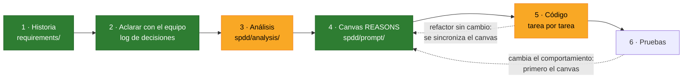
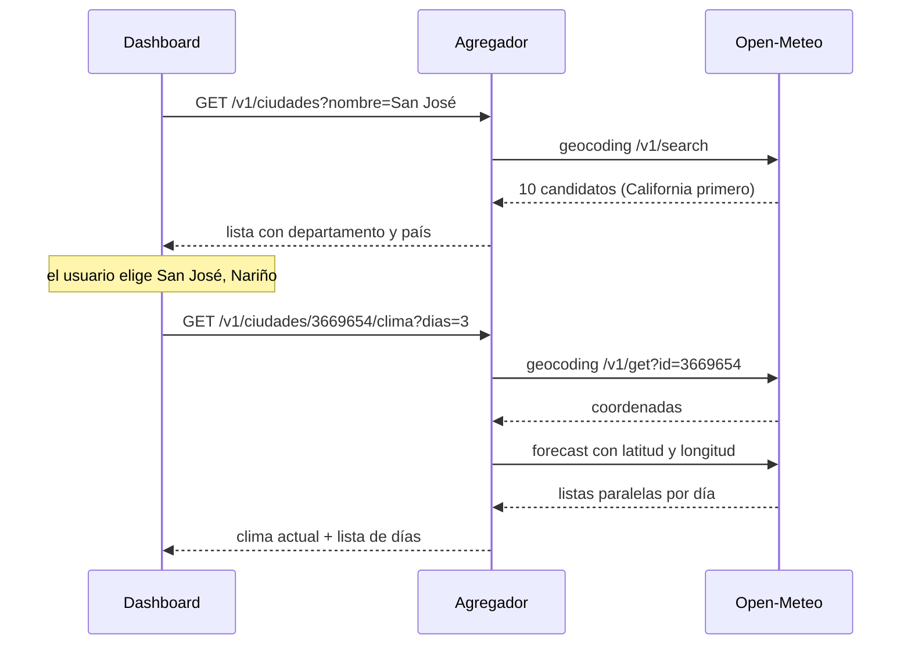
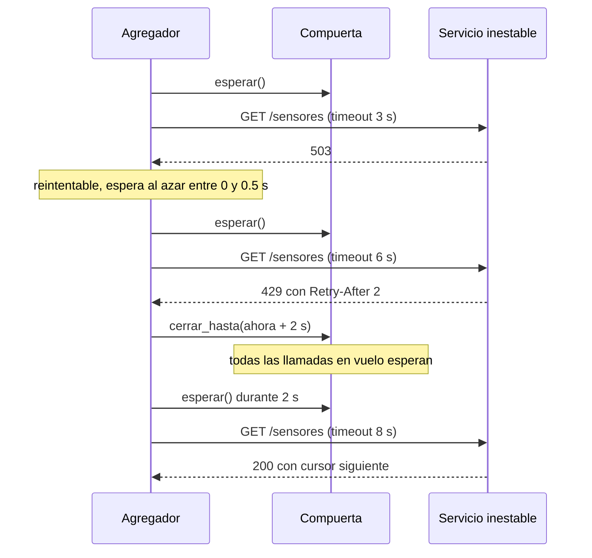

# Agregador resiliente de APIs

Parcial 2 de Sistemas Distribuidos (Escuela de Ingeniería de Sistemas e Informática,
UIS). Un servicio en FastAPI que consume **Open-Meteo** y un servicio de sensores que
falla a propósito, y expone una API propia que sigue respondiendo bien aunque sus
dependencias fallen.

> **Para el docente: dónde está cada entregable** (sección 6 del
> [enunciado](requirements/enunciado/enunciado.md))
>
> | Entregable | Dónde |
> |---|---|
> | Integrantes y rol de cada uno | [Integrantes y roles](#integrantes-y-roles) |
> | API elegida | **Open-Meteo**: geocodificación → pronóstico ([D01](#log-de-decisiones), [rutas](#qué-vamos-a-construir)) |
> | Cómo arrancar el servicio inestable y el agregador | [Cómo arrancar](#cómo-arrancar-el-servicio-inestable-y-el-agregador): `docker compose up -d --wait` |
> | URL del servicio inestable por variable de entorno | `SERVICIO_INESTABLE_URL` ([cómo apuntar a su propia instancia](#cómo-arrancar-el-servicio-inestable-y-el-agregador)) |
> | Código fuente y `requirements.txt` | [`agregador/`](agregador/) y [`requirements.txt`](requirements.txt) |
> | Tabla de latencias con caché y sin ella | [Latencia con caché y sin ella](#latencia-con-caché-y-sin-ella) |
> | Demostración de idempotencia | [Demostración de idempotencia](#demostración-de-idempotencia) |
> | Evidencias de los reintentos | [Evidencias](#evidencias-de-los-reintentos) y la carpeta [`evidencias/`](evidencias/) |
> | Colección de peticiones de prueba | [Pruebas](#pruebas): `docker compose run --rm pruebas` |
> | Respuestas a las preguntas de la Parte D | [Preguntas de análisis](#preguntas-de-análisis-parte-d) |
> | Cómo están hechos los reintentos, función por función | [D12 en detalle](#d12-en-detalle-reintentos-función-por-función) |
> | Parte E: consumo cruzado y qué le faltó o sobró al contrato | [Parte E](#parte-e-consumo-cruzado) |

El requerimiento se trabaja con **SPDD** (Structured Prompt-Driven Development): se
decide y se escribe la especificación antes de generar código, y cada decisión queda
registrada en este README.

## Estado

> **Fase actual: código del backend (paso 5 de SPDD).** El canvas está revisado y hay
> 51 decisiones tomadas y 1 pendiente (P24, el canvas del dashboard). Se genera tarea por tarea, según la sección
> Operations del [canvas](spdd/prompt/).



Verde: terminado. Amarillo: en curso. El [canvas del backend](spdd/prompt/) está
revisado y el código va en curso; al análisis le falta la revisión del equipo.

## Integrantes y roles

| Integrante | Código | Rol |
|---|---|---|
| Javier Alexi Chacón Suárez | 2160044 | Servicio inestable con Docker, y resiliencia: reintentos, compuerta y log de evidencias |
| Maria Fernanda Ruiz Velasquez | 2253689 | Cliente de Open-Meteo, y API propia + pruebas + README: rutas de ciudades y alertas, caché, idempotencia y colección de pruebas |

Los roles salen de [D40](#log-de-decisiones).

## Qué vamos a construir

Todo lo que se ejecute corre en contenedores Docker ([D16](#log-de-decisiones)): el
agregador, el servicio inestable, las pruebas y la medición de latencia. También con
el docente: no hay plan B fuera de Docker ([D23](#log-de-decisiones)).

API propia (todo bajo `/v1`, salvo la salud):

| Método y ruta | Qué hace | Dependencia |
|---|---|---|
| `GET /v1/ciudades?nombre=&pais=` | Candidatos de una búsqueda, con departamento y país; lista vacía si no hay ninguno | Open-Meteo geocoding `search` |
| `GET /v1/ciudades/{id}/clima?dias=` | Clima actual y pronóstico por día de la ciudad elegida, con `Cache-Status` | Open-Meteo geocoding `get` → `forecast` |
| `GET /v1/sensores` | Todos los sensores con su lectura, tolerando fallos | Servicio inestable (paginación + lecturas) |
| `POST /v1/alertas` | Crea una alerta de umbral (201 + `Location`); idempotente con `Idempotency-Key` obligatoria | Ninguna |
| `GET /v1/alertas` y `GET /v1/alertas/{id}` | Lista las alertas o trae una | Ninguna |
| `GET /v1/libros?titulo=` | Una obra y su autor (Parte E, D44): caché de 10 min y `Cache-Status` | La API del grupo de Open Library |
| `GET /v1/metricas` | Reintentos por causa, caché, latencias y estado de las dependencias, para el panel de resiliencia | Ninguna |
| `GET /salud` | Comprobación de vida del agregador | Ninguna |
| `GET /dashboard` | Dashboard con las cuatro vistas de D10: resiliencia (lee `/v1/metricas` cada 3 s), pronóstico con buscador, comparar ciudades, y sensores vs exterior | Nuestra propia API |


Cómo se encadenan las llamadas a Open-Meteo cuando el usuario busca una ciudad:



## Metodología: SPDD

SPDD es un método de Thoughtworks (publicado en el sitio de Martin Fowler en abril
de 2026) que trata los prompts como artefactos de ingeniería versionados junto al
código. El prompt estructurado se llama **canvas REASONS**:

| Letra | Sección | Pregunta que responde |
|---|---|---|
| R | Requirements | ¿Qué problema resolvemos y cuándo está terminado? |
| E | Entities | ¿Qué entidades hay y cómo se relacionan? |
| A | Approach | ¿Con qué estrategia lo resolvemos? |
| S | Structure | ¿Dónde encaja en el sistema? |
| O | Operations | ¿En qué pasos concretos y verificables se implementa? |
| N | Norms | ¿Qué convenciones aplican a todo? |
| S | Safeguards | ¿Qué no se puede romper nunca? |

Reglas que seguimos:

1. Primero la historia, después el análisis, después el canvas, y solo entonces el
   código, revisando en equipo entre cada paso.
2. **Cuando la realidad diverge, se corrige primero el canvas** y después el código.
   Un refactor que no cambia el comportamiento va al revés: código primero y luego se
   sincroniza el canvas.
3. SPDD no trae un log de decisiones propio. Lo agregamos aquí y cada decisión dice a
   qué sección del canvas alimenta, para que el canvas pueda citarla.

| Carpeta | Contenido |
|---|---|
| [`requirements/`](requirements/) | Historias y criterios de aceptación (paso 1), y el [enunciado del docente](requirements/enunciado/enunciado.md) |
| [`spdd/analysis/`](spdd/analysis/) | Análisis: exploración de Open-Meteo y del servicio inestable (paso 3) |
| [`spdd/template/`](spdd/template/) | Plantilla del canvas REASONS |
| [`spdd/prompt/`](spdd/prompt/) | Canvas REASONS: el del backend, en revisión (paso 4) |

Los archivos siguen el patrón del artículo: `ID-AAAAMMDDhhmm-[Tipo]-descripcion.md`.

## Log de decisiones

D01–D16 se tomaron el 2026-10-17. La ronda 0 es lo que el equipo trajo decidido; de
la 1 a la 3 se iteró con el agente antes de escribir nada; la 4 la propuso el equipo
después de abrir el PR. La ronda 5 (2026-10-23) cerró los pendientes de resiliencia
con el apoyo de una simulación (sección 4 del [análisis](spdd/analysis/), hallazgos
M1–M6), y confirmó D07 y los supuestos S1–S3. La 6 la propuso el equipo después de
abrir el PR de la ronda 5. La 7, el mismo día, cerró la idempotencia y cómo se arma
Docker; lo de Docker se verificó con Compose antes de registrarlo (hallazgos C5–C7
del análisis). La 8, también el mismo día, cerró los nueve pendientes que quedaban:
caché, medición, métricas, evidencia, alcance y roles. La 9 cerró P23 con el texto del
enunciado, y la 10 salió al probar el código contra el servicio real (hallazgo C8). En la 11, el
mismo día de la entrega, el equipo descartó la Parte E. En la 12 (2026-10-24) la retomó, porque
apareció el grupo de Open Library con su API publicada, y fijó cómo consumirla (D44–D48) y
cómo publicar la nuestra para ellos (D49). En la 13 (2026-10-25), antes de fusionar, el
equipo ajustó los reintentos y la caché hacia el otro grupo (D50, D51).

| ID | Decisión | Alternativas descartadas | Por qué | REASONS | Ronda |
|---|---|---|---|---|---|
| D01 | API externa: **Open-Meteo** | Frankfurter, Nager.Date, PokeAPI, Open Library, datos.gov.co | Elección del equipo; permite encadenar geocodificación → pronóstico sin clave | R | 0 |
| D02 | Metodología **SPDD** con log de decisiones en este README | Desarrollo directo sin especificación | Elección del equipo; deja trazable por qué el código es como es | N | 0 |
| D03 | **Repo propio del grupo**; en el vault personal queda solo una nota con el enlace | Dentro del vault; vault ahora y repo después | Es trabajo en grupo y todos deben poder clonar y hacer push | S | 1 |
| D04 | Endpoints **separados** para clima y para sensores | Agregar un resumen de campus; un solo endpoint combinado | Cada parte se prueba y se explica sola; los fallos de un origen no contaminan al otro | S | 1 |
| D05 | Nombre ambiguo → **lista de candidatos con su país**, elegida en un buscador del dashboard | Tomar el primero con filtro de país; tomar solo el primero | «San José» da 10 resultados y el primero es California; el usuario debe ver y elegir | R | 1 |
| D06 | Log visualizado como **tabla + diagramas Mermaid** | Línea de tiempo; solo tabla | Se ve en GitHub y en Obsidian sin herramientas extra | N | 1 |
| D07 | Ciudades en dos endpoints: búsqueda `GET /v1/ciudades?nombre=&pais=` y clima por id `GET /v1/ciudades/{id}/clima` | `GET /v1/ciudades/{nombre}/clima` del catálogo | Derivada de D05: el id identifica una sola ciudad, y `get` + `forecast` son las dos llamadas distintas que exige el taller. *Propuesta en la ronda 2 sin objeciones y confirmada en la ronda 5.* | O | 2 |
| D08 | Dashboard en **HTML + JS (Chart.js)** servido por el mismo FastAPI | Streamlit; frontend aparte en React/Vite | Un solo proceso para el docente, sin CORS, dentro de las tecnologías del taller | S | 2 |
| D09 | **Backend primero** (partes A–D), dashboard después | En paralelo; dashboard desde el inicio | La rúbrica no da puntos por el dashboard; si falta tiempo, que falte lo que no suma. *Con D39, la Parte E va entre el backend y el dashboard.* | O | 2 |
| D10 | Dashboard con 4 vistas: **resiliencia, pronóstico, comparar ciudades, sensores y exterior vs interior** | Subconjuntos | El panel de resiliencia muestra en vivo lo que sí se califica; la relación exterior vs interior se arma en el dashboard llamando a los dos endpoints | R | 2 |
| D11 | Repo en `javierchacon262/agregador-resiliente`, **público** | Privado con colaboradores; organización del grupo | Elección del equipo. Riesgo aceptado: otros grupos pueden ver el código antes de la entrega | S | 2 |
| D12 | Reintentos **a mano**, con **cada función explicada en este log** ([detalle abajo](#d12-en-detalle-reintentos-función-por-función)) | tenacity; reintentos del transporte de httpx (solo reintentan errores de conexión, no 503 ni 429) | Es lo que más pesa en la evaluación (30 puntos) y cualquiera del grupo debe poder explicarlo | A | 3 |
| D13 | Timeout de lectura **adaptativo: 3 s → 5 s → 8 s** según el intento | 3 s fijo; 5–6 s fijo | El primer intento corta rápido las respuestas lentas y los siguientes toleran la latencia (4 s, o 5 s del docente). *Ajustada por D19 a 3 → 6 → 8 s: el de 5 s no toleraba los 5 s.* | A | 3 |
| D14 | Lecturas con **máximo 4 a la vez + compuerta compartida de Retry-After** | Secuencial; bajo demanda desde el navegador | El bloqueo por 429 es por IP: sin compuerta, las llamadas en vuelo aparecerían como «no respetó Retry-After» en el log del docente. *Ajustada por D42: la compuerta no alcanzaba a las peticiones que ya habían salido; se agrega un turno de envío.* | A, S | 3 |
| D15 | Fallo parcial: **devolver siempre lo obtenido**, marcado como incompleto | Páginas todo o nada y lecturas parciales; todo o nada | Más disponibilidad para el dashboard. El caso sin datos (riesgo R1) lo cierra D21 | A | 3 |
| D16 | **Docker para todo lo que se ejecute**: agregador, servicio inestable, pruebas y medición de latencia | Solo `venv` local (lo que asumía el enunciado y lo que había recomendado el agente); Docker opcional | Según el equipo, la reproducibilidad y la desplegabilidad del prototipo son temas importantes de la evaluación. Cómo se arma queda en P16–P21. Ver el riesgo R4 | S, N | 4 |
| D17 | Máximo **6 intentos** por llamada al servicio inestable, configurable. Cierra P08 junto con D18 | 3 (la propuesta de P08), 4 y 5 | En la simulación, con 3 intentos solo sale completa el 8,9 % de las respuestas de `GET /v1/sensores` (0,9 % con los parámetros del enunciado); con 6, el 85 % (59 %), por unos 6 s más de mediana. Las páginas van en serie y una perdida se lleva las siguientes (M1, M2) | A | 5 |
| D18 | **Plazo por petición recibida**: 45 s en `/v1/sensores` y 15 s en los de Open-Meteo, configurables. Cada intento usa `mín(su timeout, lo que queda del plazo)` y no se duerme una espera que pase del plazo. Cierra P08 y R2 | 30 s; 20 s por cada llamada saliente (la propuesta de P08); sin plazo, solo intentos | Un plazo por llamada no acota la petición: 5 páginas en serie más las lecturas pasan del minuto. 45 s casi no baja la completitud frente a no tener plazo; 30 s la baja del 58 % al 39 % con el enunciado (M3) | A | 5 |
| D19 | Timeouts de lectura **3 → 6 → 8 s**. Modifica D13 | 3 → 5 → 8 s (D13 tal cual); 6 → 8 → 8 s, sin corte rápido | Con `--latencia 5` el timeout de 5 s también cortaba las lentas: 48 % de respuestas completas frente a 58 % (M4). Se mantiene el corte de 3 s del primer intento para que la evidencia muestre timeouts reintentados (M5) | A | 5 |
| D20 | **504** si el último intento terminó en timeout o se acabó el plazo; **502** si la dependencia respondió con error (503, 429 o error de conexión hasta agotar los intentos) o con datos que no cumplen el modelo. El cuerpo dice la dependencia, la causa y los intentos. Cierra P12 | 504 solo por timeout y 502 en lo demás (la propuesta de P12); siempre 502 | 504 es «la dependencia no respondió a tiempo», y un plazo agotado también lo es. Distinguir los dos le dice al cliente qué pasó, y la rúbrica califica los códigos de estado | R, A | 5 |
| D21 | `GET /v1/sensores` responde **502/504** (según D20) si no obtuvo ningún sensor **o ninguna lectura**; si hay al menos una lectura, 200 con `completo: false` y el motivo (D15). Cierra P09 y R1 | Solo cuando falta la primera página (lo que había recomendado el agente); 200 vacío con `completo: false` | Elección del equipo: una lista de sensores sin ningún valor se trata como fallo de la dependencia, no como resultado parcial. En la simulación pasa el 0,5 % de las veces (defecto) y el 1,9 % (enunciado) | R, A | 5 |
| D22 | **Reintentos también hacia Open-Meteo**, con la misma función y reglas, sin compuerta (no manda Retry-After, E10), máximo 3 intentos y plazo de 15 s. Los **errores de conexión** (conexión rechazada o cortada) se reintentan hacia las dos dependencias. Cierra P11 | Igual que sensores, con 6 intentos; solo errores de conexión y timeouts; no reintentar Open-Meteo | Un fallo pasajero de Open-Meteo no debería volverse un 502 si un segundo intento lo resuelve. Pero es estable y la IP de la sala es compartida (E13): si manda un 429, insistir 6 veces perjudica a todos | A | 5 |
| D23 | **Nada fuera de Docker**, tampoco con el docente: no hay plan B con `venv`. Cierra P20 y R4 | Plan B con `venv` documentado en el README (la propuesta de P20) | El docente confirmó que corre todo en Docker. Un plan B no cubriría ningún caso real y obligaría a mantener instrucciones duplicadas y a probar el código fuera del contenedor (S2) | S, N | 6 |
| D24 | Una alerta es un **umbral registrado**: objetivo (ciudad por id o sensor), variable, condición y umbral. `POST /v1/alertas` la crea (201 + `Location`), `GET /v1/alertas` las lista y `GET /v1/alertas/{id}` trae una (404 si no existe). Solo se guarda, no se evalúa, y vive en memoria: se pierde al reiniciar el contenedor. Cierra P06 | Umbral evaluado al consultar; solo el POST | El recurso sigue sin dependencias externas, así que la idempotencia se demuestra sin el ruido de los fallos. Un recurso que se crea y se puede leer es mejor diseño de API, y el 201 tiene a dónde apuntar con `Location` | R, E | 7 |
| D25 | `Idempotency-Key` **obligatoria**, según el borrador IETF: sin clave → 400; misma clave y mismo cuerpo → la respuesta guardada, sin crear otra alerta; misma clave con otro cuerpo → 422; misma clave con la primera en curso → 409. El cuerpo se compara por su huella (SHA-256 del JSON normalizado) y las claves duran 24 h en memoria. Cierra P07 | Clave opcional (como Stripe); mínima, solo repetir la respuesta | Una clave obligatoria deja claro en `/docs` qué garantiza la API. El 422 y el 409 cubren los errores reales de un cliente que reintenta: reutilizar una clave con otro cuerpo, o reintentar antes de que llegue la primera respuesta | R, A | 7 |
| D26 | Colección de pruebas en **pytest + httpx**, en la misma imagen que la medición de latencia. Cada prueba es una petición o una cadena, con un docstring que dice qué demuestra; contra el servicio inestable se afirman invariantes (200, 502 o 504; `completo` coherente), no resultados exactos. Cierra P22, un pendiente nuevo que salió de P16 y P21 en esta ronda | Hurl; Postman + newman | Un solo lenguaje y una sola imagen para las pruebas y la latencia (P04). El docente corre un comando y ve qué pasa y qué falla | O, N | 7 |
| D27 | **Sin CI**: se prueba a mano, con la colección (D26), antes de cada entrega. Cierra P21 | CI completa en cada PR (lo que había recomendado el agente); CI que solo construye y comprueba `/salud` | Elección del equipo. La reproducibilidad depende de esa prueba manual desde un clon limpio (punto 6 de la definición de terminado). Ver el riesgo R5 | N | 7 |
| D28 | **Una imagen y un Dockerfile para tres servicios** de Compose, con distinto comando: `agregador`, `servicio-inestable` (`servicio_inestable.py` sin modificar, con `--host 0.0.0.0`) y `pruebas` (pytest y latencia), este último bajo el perfil `pruebas` y con `docker compose run --rm pruebas`. Los parámetros del servicio inestable van por variables con valores por defecto (`TASA_FALLOS=0.4 LATENCIA=5 docker compose up`). Cierra P16 | Una imagen por servicio; parámetros fijos en el Compose | Un solo build para el docente, que cambia los parámetros sin editar archivos. Verificado: los parámetros llegan al servicio (C5) | S | 7 |
| D29 | Imagen base **fijada por tag exacto y digest**: `python:3.12.15-slim-trixie@sha256:a0f57064cbdcd6285fa45f51237ab0b35ea8ebaed06a1f5973e89e19dfb86704`. Además: `requirements.txt` con versiones exactas, usuario no root, `PYTHONUNBUFFERED=1` y `CMD` en forma exec. Cierra P17 | Tag exacto sin digest; tag flotante `python:3.12-slim` | Es la misma imagen byte a byte en cualquier máquina, de la entrega a la revisión; actualizarla es a mano. `PYTHONUNBUFFERED` hace que los logs salgan desde el arranque (C2) y el `CMD` exec deja que `docker stop` termine limpio (C4) | S, N | 7 |
| D30 | `SERVICIO_INESTABLE_URL`, por defecto `http://servicio-inestable:9000`, con dos casos documentados: (A) el servicio del Compose con los parámetros del docente; (B) su propia instancia en otro contenedor publicado en su máquina, con `http://host.docker.internal:9000`. El Compose trae `extra_hosts: ["host.docker.internal:host-gateway"]` para que B funcione en Linux. Cierra P18 | Solo el del Compose; red de Docker compartida | Cubre las dos formas en que el docente puede tener «su propia instancia» sin pedirle que sepa de redes de Docker. Verificado: sin `extra_hosts`, en Linux el nombre no resuelve (C6) | S | 7 |
| D31 | Healthcheck a `/salud` en los dos servicios, con Python (la imagen no trae `curl`). **El agregador no espera al servicio inestable**; las pruebas esperan a que los dos estén sanos, y `docker compose up --wait` vuelve cuando están listos. Cierra P19 | El agregador espera al servicio (`depends_on: service_healthy`, la propuesta de P19); sin healthchecks | El agregador es resiliente: si el servicio no está, reintenta y responde 502/504 (D20, D22), y así arranca igual en el caso B de D30. Verificado: los chequeos no aparecen en el log del servicio, que es la evidencia (C7) | S | 7 |
| D32 | **Caché con TTL, a mano** (diccionario y reloj monotónico, en memoria): 24 h para la búsqueda y la ficha de una ciudad, 15 min para el pronóstico. Los sensores **no** se cachean. Cierra P02 | Pronóstico 5 min; vencer cuando Open-Meteo refresque (`current.time` + `interval`) | Las ciudades no cambian. 15 min es el intervalo con el que Open-Meteo refresca el dato actual (E11): en el peor caso el dato llega con unos 30 min. Los sensores no se cachean porque su endpoint es el que demuestra la resiliencia | A | 8 |
| D33 | `Cache-Control: no-cache` en la petición **se salta la caché** y guarda la respuesta nueva. Las respuestas que usan caché llevan **`Cache-Status`** (RFC 9211): `agregador; hit; ttl=842`, `agregador; fwd=uri-miss; stored`, `agregador; fwd=request; stored` o `agregador; fwd=stale; stored`, con una entrada por caché (ciudades y pronóstico) cuando usó las dos. Cierra P03 | `X-Cache: HIT/MISS` (la propuesta de P03); parámetro `?cache=no` | Son las dos cabeceras estándar de HTTP para esto, y `Cache-Status` además dice por qué se fue a Open-Meteo (no estaba, venció o se la saltó), lo que sirve al medir y al explicar la caché | R, A | 8 |
| D34 | **Medición de latencia**: un script en el contenedor de pruebas (D26) hace 20 peticiones en frío (con `no-cache`) y 20 en caliente a `/v1/ciudades/{id}/clima`, de a una, y produce la tabla del README con mediana, p95 y máximo. Cierra P04 | 100 + 100; herramienta de carga (oha, hey) | Mide desde el cliente lo que vería el usuario, con pocas llamadas a Open-Meteo desde la IP compartida (E13). Con 20 muestras el p95 es la segunda peor, y así se debe leer | O | 8 |
| D35 | **`GET /v1/metricas`** en JSON, con contadores en memoria desde el arranque: intentos y fallos por causa y por dependencia, respuestas 502/504, aciertos y fallos de caché, latencia por endpoint (mediana y p95 de las últimas 100) y estado de la compuerta. Lo lee el panel de resiliencia (D10). Cierra P05 | `/metrics` para Prometheus; sin endpoint de métricas | El panel muestra en vivo lo que se califica (reintentos y Retry-After), y JSON es lo que el dashboard en Chart.js lee sin parsear | R, S | 8 |
| D36 | Búsqueda sin coincidencias → **200 con lista vacía**; el 404 queda para `/v1/ciudades/{id}` con un id que no existe. Cierra P10 | 404 | Una búsqueda vacía no es un recurso inexistente. Open-Meteo también responde 200 (E1), y el id inexistente da 400, que traducimos a 404 (E6) | R | 8 |
| D37 | **Log de evidencias en texto**, por stdout, una línea por intento: hora con milisegundos en el formato del servicio, id de la petición recibida, dependencia, intento n/máximo, método y URL, resultado, espera y Retry-After; y una línea final por petición. Los contenedores quedan en UTC, la zona por defecto de la imagen. Cierra P13 | JSON por línea; texto y también JSON | Se lee al lado del log del servicio inestable en la sustentación: con la misma forma de hora y la misma zona se ve, línea a línea, que el intento siguiente salió después de vencer el Retry-After. El id separa las peticiones que van en paralelo (D14) | N | 8 |
| D38 | **Plantillas propias** de `spdd/template/` para seguir SPDD. Cierra P14 | CLI comunitaria OpenSPDD | Ya existen y funcionan con cualquier agente o a mano, todo lo hecho sigue ese formato y no hay nada que instalar | N | 8 |
| D39 | **Sí a la Parte E** (consumo cruzado, +10), después del backend y **antes del dashboard**. Lo que pide exactamente se detalla en el canvas. Cierra P15. *Ajustada por D43: no se hace.* | Hacerla después del dashboard; no hacerla | Sigue la lógica de D09: suma +10 y el dashboard no suma, así que si falta tiempo, que falte el dashboard | O | 8 |
| D40 | **Roles**: Javier, servicio inestable con Docker y resiliencia (reintentos, compuerta y log de evidencias); Maria Fernanda, cliente de Open-Meteo y API propia + pruebas + README (rutas de ciudades y alertas, caché, idempotencia y colección). El dashboard y la Parte E se reparten al terminar el backend. Cierra P01 | Javier con Open-Meteo y resiliencia; Javier con resiliencia y API propia | Cada uno es dueño de una dependencia de punta a punta: la resiliencia se prueba contra el servicio inestable, y las rutas de ciudades dependen del cliente de Open-Meteo | O | 8 |
| D41 | La **Parte E** es la del enunciado: consumir un endpoint de otro grupo usando únicamente su documentación OpenAPI, y reportar en el README qué le faltó o le sobró al contrato. Su canvas se escribe al terminar el backend (D39). Cierra P23 | — | No había nada que decidir: faltaba el texto, y el enunciado ya está en [`requirements/enunciado/`](requirements/enunciado/enunciado.md) | R, O | 9 |
| D42 | **Turno de envío** al servicio inestable: siguen hasta 4 lecturas en vuelo (D14), pero salen de a una; cada envío retiene el turno hasta que llega su respuesta o pasan 0,25 s (`VENTANA_ENVIO_S`), y un 429 cierra la compuerta antes de soltarlo. Modifica D14 | Una lectura a la vez; dejarlo como estaba y explicarlo en la sustentación | La compuerta frena lo que no ha salido, pero no puede retirar lo que ya va por la red: con 4 a la vez, el servicio registró 15 «no respetó Retry-After» en 6 llamadas. Con el turno, 0 en 79 respuestas 429 y 12 de 12 respuestas completas, con una mediana de 16–19 s (C8). Una lectura a la vez sumaría en serie las respuestas lentas y chocaría con el plazo de 45 s | A, S | 10 |
| D43 | **No se hace la Parte E.** Modifica D39 *Ajustada por D44: sí se hace.* | Hacerla con la URL de otro grupo | Elección del equipo el día de la entrega: no hay otro grupo con su agregador disponible para consumirlo. Son +10 de bonificación, así que no restan | O | 11 |
| D44 | **Sí se hace la Parte E**, consumiendo la API del grupo de **Open Library** (`GET /v1/libros?titulo=`), solo con su `openapi.json`. Modifica D43 | Mantener D43 y no hacerla | Apareció un grupo con su agregador publicado por un túnel de Cloudflare, y su API respondió en las pruebas. Son +10 de bonificación. A cambio, ellos consumen la nuestra por otro túnel | R, O | 12 |
| D45 | Nuestra ruta es **`GET /v1/libros?titulo=`**: devuelve la obra y su autor tal como los da el otro grupo, con nuestros nombres | `GET /v1/consumo-cruzado/libros?titulo=` | Un recurso «libros» se entiende solo en `/docs`; que venga de otro grupo es un detalle de implementación, igual que Open-Meteo detrás de `/v1/ciudades` | R, S | 12 |
| D46 | Hacia el otro grupo, **3 intentos con timeouts de lectura de 4 → 6 → 8 s y plazo de 20 s** por petición, con las reglas de reintento selectivo de D12 y sin compuerta (no manda Retry-After) *Ajustada por D50: 2 intentos de 10 s y plazo de 25 s.* | 2 intentos de 10 s y plazo de 25 s; los de Open-Meteo (3 → 6 → 8 s) | Su API tardó entre 3,7 y 8 s en las pruebas. El primer intento corta rápido cuando están ágiles y los siguientes toleran los casos lentos, como en D19. El peor caso es 18 s más las esperas, y el plazo de 20 s lo acota | A | 12 |
| D47 | **Caché de 24 h** para `GET /v1/libros`, con la misma caché de D32 y `Cache-Status` (D33) *Ajustada por D51: 10 min.* | Sin caché | El autor de una obra no cambia, y su API tarda segundos y corre en el computador de otro grupo: la caché evita cargarla con la misma pregunta | A | 12 |
| D48 | La dirección del otro grupo va en **`OTRO_GRUPO_URL`**, con la URL de su túnel como valor por defecto | Sin valor por defecto: la ruta responde 502 si no se configura | Arranca sin configurar nada, como el resto (D28). La URL de un túnel rápido cambia si lo reinician; entonces solo se cambia la variable al arrancar | S, N | 12 |
| D49 | **Nuestra API se publica para el otro grupo con un túnel rápido de Cloudflare**, que corre en Docker en el computador de Maria Fernanda (`cloudflare/cloudflared:2025.10.0`, en la red del Compose, apuntando a `http://agregador:8000`), y solo mientras ellos prueban. No toca el código ni el Compose: se prende y se apaga aparte | La IP de la red local (`http://192.168.1.24:8000`), que solo sirve en la misma wifi; desplegar el agregador en la nube; ngrok | Los dos grupos no están en la misma red, y es lo mismo que usó el otro grupo, sin cuenta ni configuración. Corre en Docker, como todo lo demás (D16). La URL cambia cada vez que se prende, no tiene garantía de disponibilidad, y mientras está prendido cualquiera con la URL puede usar la API (no hay datos privados). Se prende con un comando que corre la persona, no el agente | S, O | 12 |
| D50 | Hacia el otro grupo, **2 intentos de hasta 10 s cada uno y plazo de 25 s** por petición, con las mismas reglas de reintento selectivo y sin compuerta. Modifica D46 | Mantener D46 (3 intentos, 4 → 6 → 8 s, plazo de 20 s) | Elección del equipo antes de fusionar: su API corre en el computador de otro grupo y tarda segundos. Con 10 s, casi cualquier respuesta suya alcanza a llegar en el primer intento, y con 2 intentos no se les carga con peticiones de más. El peor caso es 10 + 10 s más la espera entre los dos, dentro de los 25 s | A | 13 |
| D51 | **Caché de 10 min** para `GET /v1/libros`. Modifica D47 | Mantener D47 (24 h) | Elección del equipo antes de fusionar: es un servicio que no controlamos y que puede cambiar o corregir sus datos; con 10 min, un cambio suyo se ve pronto, y la caché sigue evitando preguntarles lo mismo varias veces seguidas | A | 13 |

### Riesgos y matices

| ID | Riesgo | Qué hacer |
|---|---|---|
| R1 | D15 choca con el enunciado cuando **no se obtiene nada**: exige «502 o 504 si la dependencia falla» y prohíbe el 500 genérico | **Cerrado por D21**: sin sensores o sin ninguna lectura, 502/504. Queda para el dashboard: una lista incompleta debe marcarse en sus estadísticas. |
| R2 | Con D13 el peor caso se alarga: 3 + 5 + 8 + 8 s de timeouts más las esperas pasa de 25 s | **Cerrado por D17 y D18**: 6 intentos por llamada, pero ninguna petición pasa de su plazo (45 s en sensores, 15 s en Open-Meteo). |
| R3 | D11: el repo es público antes de la entrega | Aceptado por el equipo. |
| R4 | D16 depende de que el docente tenga Docker. En el taller de FastAPI de esta misma materia se dijo que no lo tenía, y el enunciado pide no instalar nada que exija reiniciar (Docker Desktop en Windows suele pedir WSL2 y un reinicio) | **Cerrado por D23**: el docente confirmó que corre todo en Docker. |
| R5 | D27: sin CI, un Dockerfile o un Compose roto solo se detecta en la prueba manual | Aceptado por el equipo. Antes de cada entrega: clon limpio, `docker compose up --wait` y `docker compose run --rm pruebas`. |

### D12 en detalle: reintentos, función por función

> **Las ocho funciones describen el código real**, con la misma numeración: la 1–6 en
> [`agregador/resiliencia.py`](agregador/resiliencia.py) y la 7–8 en
> [`agregador/clientes/sensores.py`](agregador/clientes/sensores.py). Sus pruebas están
> en [`pruebas/test_resiliencia.py`](pruebas/test_resiliencia.py) y
> [`pruebas/test_sensores.py`](pruebas/test_sensores.py). Si el código cambia, esta
> sección cambia con él (regla 4 de AGENTS.md). Los números salen de variables de
> entorno, con los valores por defecto de la tabla de Norms del canvas.

Así se ve el comportamiento en un caso con 503, 429 y éxito:



**1. `es_reintentable(resultado)` → sí/no**, donde `resultado` es la respuesta o el error
- *Qué hace:* decide si vale la pena repetir. **Sí** con 503, 429, timeout y errores
  de conexión: conexión rechazada, cortada o con el protocolo roto (D22). **No** con
  400, 404, cualquier otro 4xx ni otro 5xx (500, 502, 504), ni con un error de
  configuración como una URL sin esquema. Un 2xx no es fallo.
- *Por qué:* un 503, un 429, un timeout o una conexión caída son pasajeros (por
  ejemplo, el servicio se está reiniciando). Un 400 o un 404 son definitivos: repetir
  da la misma respuesta y gasta peticiones de la dependencia. Todas nuestras llamadas
  salientes son GET, así que repetirlas no tiene efectos secundarios.
- *Rúbrica:* «reintentos selectivos».

**2. `leer_retry_after(respuesta)` → segundos o nada**
- *Qué hace:* lee la cabecera `Retry-After` y la convierte en segundos. El servicio
  manda segundos enteros; el estándar HTTP (RFC 9110) también permite una fecha.
  Acepta las dos formas e ignora los valores inválidos, como «pronto» o «-3».
- *Por qué:* es el servidor diciendo cuándo volver. Si volvemos antes, el servicio
  responde otro 429 y lo deja registrado.

**3. `calcular_espera(intento, retry_after, base, tope)` → segundos**
- *Qué hace:* backoff exponencial con **jitter completo**:
  `espera = azar(0, mín(TOPE, BASE · 2^intento))`, y si vino Retry-After,
  `espera = máx(retry_after, espera)`.
- *Ejemplo* con los valores por defecto, BASE = 0,5 s y TOPE = 8 s: intento 0 → entre
  0 y 0,5 s; intento 1 → 0–1 s; intento 2 → 0–2 s; intento 3 → 0–4 s; de ahí en
  adelante, 0–8 s.
- *Por qué exponencial:* cada fallo sugiere que la dependencia está más cargada, y
  esperar más le da aire.
- *Por qué jitter:* si muchos clientes fallan a la vez y esperan lo mismo, vuelven
  todos juntos y la tumban otra vez. Es la pregunta b de la Parte D.
- *Por qué el máximo con Retry-After:* el azar puede dar menos de lo que pidió el
  servidor; nunca hay que volver antes.

**4. `timeout_para(intento, timeouts_lectura)` → segundos de lectura**
- *Qué hace:* aplica D19, que ajustó D13. El timeout de lectura es 3 s en el primer
  intento, 6 s en el segundo y 8 s del tercero en adelante; el de conexión es fijo,
  de 2 s. `llamar_con_reintentos` arma con ellos el `httpx.Timeout` del intento, y lo
  recorta a lo que quede del plazo (D18).
- *Por qué:* casi siempre conviene cortar rápido una respuesta lenta, porque el
  siguiente intento suele caer en una normal. Pero si ya fallamos, se da más margen
  para no seguir cortando una dependencia que simplemente está lenta.
- *Por qué 6 s y no 5 s:* con `--latencia 5`, el servicio duerme 5 s antes de mandar
  nada, y un timeout de 5 s corta justo esa respuesta (hallazgo M4 del análisis).

**5. `CompuertaRetryAfter`** (una sola, compartida por todas las llamadas al servicio)
- `cerrar_hasta(instante)`: cuando llega un 429, guarda hasta cuándo no se puede
  llamar. Si ya había un cierre más largo, conserva el mayor.
- `esperar()`: se llama antes de cada petición; si la compuerta está cerrada, duerme
  hasta que abra. Duerme en bucle, porque mientras espera otro 429 puede alargar el
  cierre.
- `falta()` y `hasta`: cuánto falta para que abra y en qué instante; `/v1/metricas`
  los muestra.
- *Por qué:* el servicio bloquea **por IP**. Un solo 429 bloquea todas nuestras
  llamadas, no solo la que lo recibió. Sin compuerta, las otras llamadas en vuelo
  saldrían antes de tiempo y el log del docente las mostraría como «no respetó
  Retry-After» (D14).
- `turno`: el **turno de envío** (D42). Las peticiones al servicio salen de a una, y
  cada una retiene el turno hasta que llega su respuesta o pasan 0,25 s
  (`VENTANA_ENVIO_S`). El servicio decide el 429 antes de dormir, así que vuelve en
  milisegundos y cierra la compuerta antes de que salga la siguiente; una respuesta
  lenta suelta el turno al vencer la ventana, y las lecturas siguen en paralelo.
- *Por qué el turno:* la compuerta frena lo que todavía no salió, pero no puede
  retirar una petición que ya va por la red. Sin el turno, con 4 lecturas a la vez,
  cada 429 alcanzaba a otras peticiones en vuelo: 15 «no respetó» en 6 llamadas. Con
  el turno, 0 en 79 respuestas 429 (hallazgo C8 del análisis).
- Solo la usa el servicio inestable; Open-Meteo no manda Retry-After (D22).

**6. `llamar_con_reintentos(cliente, método, url, *, politica, fecha_limite, compuerta, metricas, params)`**
→ la respuesta, o `ErrorDependencia`

El ciclo que une todo; toda llamada saliente pasa por aquí:

```text
para cada intento desde 0 hasta política.máximo - 1:
    con el turno de envío (si hay compuerta):
        si la compuerta está cerrada:
            si abre después de la fecha límite → rendirse por plazo
            escribir la espera en la evidencia y esperar a que abra
        lanzar la petición con timeout de lectura mín(timeout_para(intento), lo que
            queda), dentro de asyncio.timeout(lo que queda): ningún intento pasa del plazo;
            si responde 429 con Retry-After, cerrar ahí mismo la compuerta
        retener el turno hasta que responda o pasen 0,25 s
    esperar la respuesta
    si respondió algo no reintentable:
        2xx o 4xx (400, 404…) → devolverlo; la ruta decide qué responder (404 → 404)
        otro 5xx              → rendirse sin reintentar (502)
    si era el último intento → rendirse
    calcular la espera; si ahora + espera pasa de la fecha límite → rendirse por plazo
    escribir la línea de evidencia y dormir la espera
rendirse = lanzar ErrorDependencia(causa, intentos enviados):
    504 si la causa es timeout o plazo; 502 en los demás casos (D20)
```

- *`Politica`:* los números de cada dependencia. `main.py` arma dos: la de los
  sensores, con `maximo = 6` (D17), y la de Open-Meteo, con `maximo = 3` (D22). Los
  sensores pasan además la compuerta, que es una sola para todo el agregador.
- *La fecha límite:* un instante de `time.monotonic()` que fija la ruta al recibir la
  petición: ahora + 45 s en `/v1/sensores` y ahora + 15 s en los de Open-Meteo (D18).
  La comparten todas las llamadas de esa petición, así que ninguna respuesta nuestra
  pasa de su plazo.
- *Cuando se rinde:* `ErrorDependencia` sube hasta el manejador de `main.py`, que
  responde 502 o 504 con el cuerpo `CuerpoErrorDependencia` (dependencia, causa e
  intentos). Nunca sale un 500 por una dependencia.
- *Por qué en un solo lugar:* así las reglas no se repiten ni se contradicen entre
  endpoints.
- *Evidencia:* cada intento escribe una línea con la hora, el id de la petición
  recibida, la dependencia, el número de intento, la URL, el resultado, la espera
  elegida y si vino Retry-After, en el formato de D37:
  `[16:40:04.512] r-7f3a sensores 2/6 GET /sensores -> 429 · Retry-After 2 s · espera 2,00 s`.
- *Métricas:* cada llamada y cada intento suman a los contadores de
  `GET /v1/metricas` (D35), por resultado.
- *Pruebas:* `pruebas/test_resiliencia.py` lo comprueba sin red, con un servidor y un
  reloj falsos: 503 → 200; Retry-After respetado; 400 y 404 sin reintento; conexión
  caída reintentada; timeouts agotados → 504; 503 agotados → 502; plazo agotado → 504;
  otro 5xx → 502 sin reintento; la compuerta frena a otra llamada; el turno no deja
  salir a otra llamada antes de saber del 429 (esa prueba falla sin el turno), y una
  línea de evidencia por intento.

**7. `recorrer_paginas(cliente, *, politica, compuerta, fecha_limite, metricas)`** →
`ResultadoPaginas`: sensores, si quedó completa, el motivo y la causa del corte
- *Qué hace:* pide `/sensores`, luego `/sensores?cursor=siguiente`, hasta que
  `siguiente` sea `null`. Cada página pasa por `llamar_con_reintentos`, con la fecha
  límite de la petición, y se valida con el modelo `PaginaSensores`.
- *Salvaguarda:* si un cursor se repite, corta, para que el recorrido termine siempre.
- *Si una página falla del todo:* devuelve lo obtenido con `completo: false` y el
  motivo, por ejemplo «la página 3 no respondió (503)» (D15). Un 400 (cursor que el
  servicio no reconoce) o una página que no cumple el modelo también cortan. Las
  páginas son el eslabón débil: sin el cursor de una no se puede pedir la siguiente
  (hallazgo M2), y por eso el máximo es de 6 intentos (D17).

**8. `leer_lecturas(cliente, ids, *, concurrencia, …)`** → una `ResultadoLectura` por
sensor, en el mismo orden: la lectura, o `None` con el motivo y la causa
- *Qué hace:* pide las lecturas con un máximo de 4 a la vez (un semáforo de asyncio,
  D14). Cada una pasa por la compuerta, el turno de envío y `llamar_con_reintentos`,
  con la misma fecha límite que las páginas. Un 404 se respeta («el sensor no existe»)
  y no se reintenta.
- *Por qué 4:* alcanza para que 23 lecturas no tarden un minuto, sin disparar decenas
  de peticiones a la vez contra un servicio que ya está fallando.

**Cómo responde `GET /v1/sensores`** ([`rutas/sensores.py`](agregador/rutas/sensores.py); D15, D21)
- Al menos una lectura → **200** con la lista. Si faltan páginas o lecturas,
  `completo: false` y el motivo, por ejemplo «3 de 23 sensores sin lectura»; cada
  sensor sin lectura dice el suyo.
- Ningún sensor, o sensores sin ninguna lectura → **502 o 504**. Si se acabó el plazo
  en cualquier parte es 504; si no, manda la causa del último fallo (D20).

## Decisiones pendientes

Los 21 pendientes originales (P01–P21), P22 (ronda 7) y P23 (al escribir el canvas)
están cerrados; cada decisión dice qué pendiente cierra. Las preguntas nuevas se agregan
aquí, y no se genera código para esa parte hasta cerrarlas.

| ID | Pregunta | Propuesta para discutir | Bloquea |
|---|---|---|---|
| P24 | El dashboard se escribió sin canvas, a pedido del equipo (2026-10-27), para tenerlo rápido: se salta la regla 1 de AGENTS.md. Falta su canvas | Escribir `spdd/prompt/…-[Feat]-dashboard.md` describiendo el código que ya existe (regla 3, como un refactor: código primero, canvas después), y decidir con el equipo lo que se fijó sin preguntar: Chart.js desde un CDN, refresco cada 3 s, exterior fijo en Bucaramanga | Cambios al dashboard |

### Supuestos (confirmados en la ronda 5)

| ID | Supuesto |
|---|---|
| S1 | La API y el código van en español, como el enunciado (`/v1/ciudades`, `alertas`). |
| S2 | Con D16, la versión de Python la fija la imagen: 3.12.15, fijada por tag y digest (D29). Como no hay plan B (D23), el código no necesita correr fuera de la imagen. |
| S3 | `servicio_inestable.py` no se modifica: es del docente y se configura por parámetros. |

## Cómo arrancar el servicio inestable y el agregador

Todo con Docker Compose ([D28](#log-de-decisiones)); no hay instrucciones sin Docker
([D23](#log-de-decisiones)). El agregador tiene todas las rutas del backend: `/salud`,
ciudades y clima, sensores, alertas y `/v1/metricas`. El contrato completo está en
<http://localhost:8000/docs>.

```bash
docker compose up -d --wait            # agregador (:8000) y servicio inestable (:9000)
curl localhost:8000/salud
curl 'localhost:8000/v1/ciudades?nombre=San%20Jos%C3%A9&pais=CO'
curl -i 'localhost:8000/v1/ciudades/3688465/clima?dias=3'     # mirar Cache-Status
curl localhost:8000/v1/sensores
curl localhost:8000/v1/metricas
docker compose run --rm pruebas        # la colección de pruebas (D26)
docker compose run --rm pruebas python pruebas/medir_latencia.py   # tabla de latencias (D34)
docker compose logs -f                 # evidencia de los reintentos (D37)
docker compose down
```

Con los parámetros del docente, sin editar nada (D28, hallazgo C5):

```bash
TASA_FALLOS=0.4 LATENCIA=5 docker compose up -d --wait
```

Variables del servicio inestable: `TASA_FALLOS`, `TASA_429`, `TASA_LENTITUD`,
`LATENCIA`, `RETRY_AFTER`, `TAM_PAGINA` y `SEMILLA`. Para apuntar el agregador a una
instancia del docente que corre en otro contenedor de su máquina, publicada en el
puerto 9000 (D30, caso B):

```bash
SERVICIO_INESTABLE_URL=http://host.docker.internal:9000 docker compose up -d --wait agregador
```

**`--host 0.0.0.0` es obligatorio dentro de un contenedor.** El servicio escucha por
defecto en `127.0.0.1`, que dentro del contenedor solo responde desde adentro; el
Compose ya lo arranca así (hallazgo C1 del [análisis](spdd/analysis/)).

## Pruebas

`docker compose run --rm pruebas` corre todo con pytest dentro de la imagen (D26), en
dos grupos:

| Archivo | Qué prueba | Necesita |
|---|---|---|
| `test_resiliencia.py` | Las funciones de «D12 en detalle», con un servidor y un reloj falsos | Nada |
| `test_cache.py` | Vencimiento del TTL, `no-cache` y los cuatro valores de `Cache-Status` (D32, D33) | Nada |
| `test_idempotencia.py` | Las cuatro reglas de D25, incluido el 409 con la primera en curso, y el vencimiento a las 24 h | Nada |
| `test_open_meteo.py` | El cliente: candidatos, `results` ausente (E1), id inexistente sin reintento (E6), listas paralelas (E7), 3 intentos y 502/504 (D20, D22) | Nada |
| `test_rutas.py` | Códigos de estado y cabeceras de ciudades y alertas, con un Open-Meteo falso que cuenta las llamadas: los 422 no gastan ninguna | Nada |
| `test_sensores.py` | La ruta de sensores con un servicio falso: completa, lectura o página que no llega, 502 sin sensores o sin lecturas, 504 por timeouts, cursor repetido y 404 sin reintento (D15, D21) | Nada |
| `test_otro_grupo.py` | La Parte E con la API del otro grupo falsa: sus campos, 404 sin reintento, 2 intentos de 10 s, su 502/504 como 502, la página HTML de Cloudflare, caché y 422 sin llamarlos (D44–D47) | Nada |
| `test_api_ciudades.py` · `test_api_alertas.py` · `test_api_sensores.py` · `test_api_libros.py` | La colección: contra el stack levantado, Open-Meteo real, el servicio inestable y la API real del otro grupo | El stack |

Para correr solo las que no necesitan el stack:
`docker compose run --rm --no-deps -e AGREGADOR_URL= pruebas`. El último reporte está en
[`pruebas/reporte-pruebas.md`](pruebas/reporte-pruebas.md).

## Latencia con caché y sin ella

`GET /v1/ciudades/3688465/clima?dias=7` (Bucaramanga), 20 peticiones en frío con
`Cache-Control: no-cache` y 20 en caliente, de a una, medidas desde el contenedor de
pruebas ([D34](#log-de-decisiones)). Se reproduce con
`docker compose run --rm pruebas python pruebas/medir_latencia.py`.

| Condición | Peticiones | Mediana (ms) | p95 (ms) | Máximo (ms) |
|---|---|---|---|---|
| Sin caché (`no-cache`) | 20 | 430,5 | 645,3 | 1 737,9 |
| Con caché (`hit`) | 20 | 1,0 | 2,0 | 2,5 |

Medido el 2026-10-23 a las 18:15 UTC. Con caché, la mediana es unas 450 veces menor:
la respuesta sale de la memoria del agregador en vez de hacer dos llamadas encadenadas
a Open-Meteo. Con 20 muestras, el p95 es la segunda peor de cada tanda.

Cada respuesta dice de dónde salió con `Cache-Status` (RFC 9211, [D33](#log-de-decisiones)),
con una entrada por caché:

```text
agregador-ciudades; fwd=uri-miss; stored, agregador-pronostico; fwd=uri-miss; stored   # primera vez
agregador-ciudades; hit; ttl=86400, agregador-pronostico; hit; ttl=900                  # segunda
agregador-ciudades; fwd=request; stored, agregador-pronostico; fwd=request; stored     # con no-cache
```

## Demostración de idempotencia

Dos peticiones iguales con la misma `Idempotency-Key` crean **una** alerta y devuelven
**la misma** respuesta ([D25](#log-de-decisiones)). Salida real, recortada a las
cabeceras que importan:

```console
$ curl -i -X POST localhost:8000/v1/alertas -H 'Content-Type: application/json' \
    -H 'Idempotency-Key: 7c1e4b2a' \
    -d '{"objetivo": {"tipo": "ciudad", "id": 3688465}, "variable": "temperatura", "condicion": "mayor_que", "umbral": 30}'
HTTP/1.1 201 Created
location: /v1/alertas/a-0001

{"objetivo":{"tipo":"ciudad","id":"3688465"},"variable":"temperatura","condicion":"mayor_que","umbral":30.0,"id":"a-0001","creada":"2026-10-23T18:16:25.624143Z"}

$ # la misma petición otra vez, como un cliente que perdió la respuesta
HTTP/1.1 201 Created
location: /v1/alertas/a-0001

{"objetivo":{"tipo":"ciudad","id":"3688465"},"variable":"temperatura","condicion":"mayor_que","umbral":30.0,"id":"a-0001","creada":"2026-10-23T18:16:25.624143Z"}

$ curl localhost:8000/v1/alertas          # una sola alerta
[{"objetivo":{"tipo":"ciudad","id":"3688465"}, … ,"id":"a-0001", … }]

$ # la misma clave con otro umbral → 422; sin clave → 400
{"detail":"Esta Idempotency-Key ya se usó con otro cuerpo"}
{"detail":"Falta la cabecera Idempotency-Key"}
```

Lo mismo, como prueba automática: `test_dos_peticiones_con_la_misma_clave_crean_una_sola_alerta`
en [`pruebas/test_api_alertas.py`](pruebas/test_api_alertas.py). El 409 (la misma clave
mientras la primera sigue en curso) no se puede provocar desde afuera, porque crear una
alerta no espera nada; lo demuestra `test_misma_clave_con_la_primera_en_curso_es_409` en
[`pruebas/test_idempotencia.py`](pruebas/test_idempotencia.py).

## Evidencias de los reintentos

`docker compose logs agregador` deja una línea por intento y una final por petición
([D37](#log-de-decisiones)). Las de sensores, contrastadas línea a línea con el log del
servicio inestable, están en [`evidencias/`](evidencias/) (más abajo). Estas son de Open-Meteo, con un agregador
apuntado a un puerto cerrado para provocar la falla: 3 intentos (D22), espera con jitter
entre ellos y 502 al rendirse (D20).

```text
[18:15:25.848] r-5f0f open-meteo 1/3 GET /v1/search?name=Bogota&count=10&language=es -> conexión fallida (ConnectError) · espera 0,24 s
[18:15:26.096] r-5f0f open-meteo 2/3 GET /v1/search?name=Bogota&count=10&language=es -> conexión fallida (ConnectError) · espera 0,95 s
[18:15:27.050] r-5f0f open-meteo 3/3 GET /v1/search?name=Bogota&count=10&language=es -> conexión fallida (ConnectError) · intentos agotados
[18:15:27.051] r-5f0f GET /v1/ciudades -> 502 (1,24 s, 3 intentos)
```

Y un id inexistente, que **no** se reintenta (salvaguarda 1, E6):

```text
[18:09:19.197] r-c0bf open-meteo 1/3 GET /v1/get?id=999999999&language=es -> 400 (205 ms)
[18:09:19.198] r-c0bf GET /v1/ciudades/999999999/clima -> 404 (0,21 s, 1 intento)
```

### Sensores, lado a lado con el log del servicio

En [`evidencias/`](evidencias/) están los dos logs de una corrida con los parámetros del
enunciado (`--tasa-fallos 0.4 --latencia 5 --semilla 42`): 3 llamadas a
`GET /v1/sensores`, 162 intentos y 22 respuestas 429, **sin ningún «no respetó
Retry-After»** en el log del servicio. Después de cada 429, nuestra siguiente petición
llegó como mínimo 2,003 s después. La [guía](evidencias/README.md) muestra los
fragmentos comentados: la compuerta frenando a otra lectura, los reintentos de una
página con timeout y jitter, y una página que se rinde y deja la respuesta incompleta
con su motivo.

## Preguntas de análisis (Parte D)

### a) ¿Por qué es peligroso reintentar un `POST` sin clave de idempotencia?

**Porque se puede crear dos veces lo mismo sin que nadie se dé cuenta.**

Una operación es **idempotente** cuando hacerla una vez o varias deja el mismo
resultado. Un `GET` lo es: pedir dos veces el clima no cambia nada. Un `POST` no lo es:
cada vez que se ejecuta puede crear algo nuevo (así lo define el estándar HTTP,
RFC 9110).

El problema es que, cuando una petición se demora demasiado, el cliente no sabe qué
pasó. Puede que no haya llegado, o puede que haya llegado y lo que se perdió fue la
respuesta.

**Ejemplo en nuestro proyecto:** el dashboard manda `POST /v1/alertas` para crear la
alerta «temperatura mayor que 30 °C en Bucaramanga», y la respuesta no llega a tiempo.

- Si reintenta y la alerta sí se había creado, quedan **dos alertas iguales**.
- Si no reintenta y no se había creado, la alerta **se pierde**.

Con una alerta, el daño es un aviso repetido. Con un pago o un pedido, sería cobrar o
enviar dos veces.

Por eso lo diseñamos así:

- Nuestros reintentos automáticos solo se aplican a peticiones `GET`, que no tienen
  efectos secundarios (D12).
- `POST /v1/alertas` exige la cabecera `Idempotency-Key` (D25). El cliente manda una
  clave única, por ejemplo `7c1e4b2a`, y si reintenta usa la misma. Así el reintento se
  vuelve una pregunta segura: «¿qué pasó con la operación 7c1e4b2a?». El servidor ve
  que esa clave ya se usó y devuelve la misma respuesta, la misma alerta `a-0001`, sin
  crear otra.

### b) ¿Qué pasaría si 50 clientes reintentaran al mismo tiempo sin jitter?

**Volverían todos al mismo instante y volverían a tumbar al servicio, una y otra vez.**

Dos términos:

- **Backoff exponencial:** después de cada fallo se espera más tiempo antes de
  reintentar. En nuestro código el techo de espera es 0,5 s, luego 1 s, 2 s, 4 s y como
  máximo 8 s.
- **Jitter:** en vez de esperar siempre ese techo exacto, cada cliente espera un tiempo
  **al azar** entre 0 y el techo. Por ejemplo, en el tercer intento, cualquier valor
  entre 0 y 2 s.

Sin jitter, si una caída hace fallar a los 50 clientes a la vez, todos esperan
exactamente lo mismo y llegan juntos: 50 peticiones a los 0,5 s, otras 50 al segundo,
otras 50 a los 2 s… Es lo que se llama **estampida** (*thundering herd*): muchos
clientes que llegan de golpe al mismo tiempo. Cada oleada encuentra al servicio igual
de cargado que la anterior, falla otra vez y prepara la siguiente. El backoff separa más
las oleadas, pero no las deshace.

**Ejemplo en nuestro proyecto:** con el servicio inestable sería todavía peor, porque
cuando se satura responde **429** («demasiadas peticiones») y **bloquea la IP** durante
el tiempo que dice la cabecera `Retry-After`, que por defecto es de 2 s. Si los 50
vuelven en el mismo segundo, pueden caer otra vez antes de que venza el bloqueo.

Con jitter, las 50 peticiones se reparten a lo largo de la espera en vez de llegar
juntas, y el servicio alcanza a recuperarse (lo explica Marc Brooker en el blog de AWS).

**Un matiz honesto de nuestro diseño:** cuando llega un `Retry-After`, esperamos el
mayor entre ese tiempo y el jitter. En los primeros intentos el jitter es menor que 2 s
(como máximo 0,5 s o 1 s), así que gana el `Retry-After`, y quienes recibieron el mismo
`Retry-After` vuelven a la vez. Dentro de nuestro agregador eso lo controla la
**compuerta**, que hace esperar juntas a todas nuestras llamadas al servicio inestable y
deja como máximo 4 lecturas en vuelo (D14), que además salen de a una por el turno de
envío (D42): así ninguna sale sin enterarse de un 429 que ya llegó. Pero si hubiera
muchos agregadores distintos, convendría sumar un poco de azar encima del `Retry-After`.

### c) ¿Qué tan desactualizados pueden estar los datos de la caché, y cuándo sería inaceptable?

**El pronóstico puede llegar con hasta unos 30 minutos de antigüedad. Eso está bien
para planear el día, pero sería inaceptable para decisiones urgentes.**

La **caché** es una copia guardada de una respuesta, para no tener que volver a pedirla.
El **TTL** (*time to live*, tiempo de vida) es cuánto dura esa copia antes de que se
descarte y se pida de nuevo.

En nuestro proyecto hay dos TTL (D32):

- **Pronóstico: 15 minutos.**
- **Ficha de la ciudad** (nombre, departamento, coordenadas): **24 horas.** No importa
  que dure tanto, porque el nombre y las coordenadas de una ciudad no cambian.

¿Por qué hasta 30 minutos? Porque **Open-Meteo** solo renueva el dato actual cada 15
minutos (E11). Se suman dos esperas:

1. Pedimos el clima de Bucaramanga cuando el dato de Open-Meteo ya tiene casi 15
   minutos, justo antes de que lo renueve.
2. Lo guardamos y lo seguimos entregando 15 minutos más, hasta que vence nuestra copia.

En total, casi 30 minutos.

**Ejemplo en nuestro proyecto:** para ver el pronóstico de Bucaramanga o comparar dos
ciudades en el dashboard, una diferencia de 30 minutos no cambia nada.

**Sería inaceptable** cuando se toman decisiones con el dato del momento:

- una alerta de tormenta o de crecida de un río;
- operaciones aéreas;
- evaluar en tiempo real las alertas de `POST /v1/alertas` (hoy solo se guardan y no se
  evalúan, D24).

En esos casos habría que bajar el TTL, hacer que la copia venza justo cuando Open-Meteo
renueva el dato, o directamente no usar caché.

Quien necesite el dato fresco ya puede pedirlo: con la cabecera
`Cache-Control: no-cache`, el agregador va directo a Open-Meteo (D33). Además, cada
respuesta trae la cabecera `Cache-Status`, que dice si salió de la caché y cuántos
segundos le quedan a la copia (por ejemplo, `ttl=842`).

### d) ¿Qué cambiaría si el servicio corriera en varias réplicas detrás de un balanceador?

**Habría que sacar de la memoria todo lo que hoy se guarda ahí y compartirlo entre las
réplicas. Si no, la idempotencia, la caché y la compuerta dejarían de funcionar bien.**

Dos términos:

- **Réplica:** una copia idéntica del agregador corriendo al mismo tiempo que otras,
  para atender más peticiones o seguir funcionando si una se cae.
- **Balanceador:** el componente que recibe cada petición y decide a qué réplica
  mandarla.

Hoy todo vive en la memoria de un solo proceso. Con varias réplicas, cada una tendría
su propia memoria, y no se enterarían de lo que pasa en las demás:

1. **Idempotencia y alertas (lo primero que se rompe).** El dashboard manda
   `POST /v1/alertas` con la clave `7c1e4b2a`, y la réplica 1 crea la alerta. El
   reintento cae en la réplica 2, que no conoce esa clave, y **crea una segunda
   alerta**: justo lo que la clave debía evitar.
   - Solución: guardar las claves y las alertas en un almacén compartido, como Redis o
     una base de datos.
   - Marcar una clave como «en curso» tendría que ser una sola operación indivisible
     entre réplicas (en Redis, `SET NX` con vencimiento), para que el 409 siga
     funcionando.
   - Los ids secuenciales (`a-0001`, `a-0002`…) se repetirían entre réplicas, así que
     harían falta ids únicos como los UUID, o una secuencia de la base de datos.
2. **Caché.** Cada réplica tendría su propia copia del pronóstico. Seguiría
   funcionando, pero:
   - habría más fallos de caché, porque hay que «llenar» cada réplica por separado;
   - habría más llamadas a Open-Meteo desde la misma IP, que en la sala comparten todos
     los grupos (E13);
   - dos peticiones seguidas al clima de Bucaramanga podrían traer datos de distinta
     antigüedad, según la réplica que conteste.

   Solución: una caché compartida, a cambio de un viaje extra por la red.
3. **Compuerta de Retry-After.** Si todas las réplicas salen a internet por la misma IP,
   un 429 del servicio inestable bloquea a todas, pero solo se entera la réplica que lo
   recibió. Las demás seguirían llamando antes de que venzan los 2 s, y el log del
   servicio las mostraría como «no respetó Retry-After». Ya nos pasó dentro de una sola
   réplica, con peticiones en vuelo (hallazgo C8), y lo resolvió el turno de envío
   (D42); entre réplicas, la compuerta y el turno tendrían que ser compartidos, o cada
   réplica tendría que estar preparada para recibir un 429 en cualquier momento.
4. **Reintentos y plazos.** Si el balanceador también reintenta por su cuenta, sus
   reintentos se multiplican con los nuestros: por ejemplo, 3 del balanceador por 6
   nuestros hacia el servicio inestable dan hasta 18 intentos por llamada. Habría que
   reintentar en una sola capa y ajustar los tiempos de espera del balanceador a
   nuestros plazos de 45 s para sensores y 15 s para Open-Meteo (D18).
5. **Métricas y evidencias.** `GET /v1/metricas` mostraría solo los números de la
   réplica que contestó. Habría que juntar métricas y logs en un sistema externo (como
   Prometheus o un colector de logs). Además, el id de cada petición tendría que
   asignarlo el balanceador, para poder seguirla aunque pase por varias réplicas.

Lo que **no** cambia: `GET /salud` sirve tal cual para que el balanceador detecte una
réplica caída y deje de mandarle peticiones.

## Parte E: consumo cruzado

Consumimos la API del **grupo de Open Library** usando **solo su contrato OpenAPI**
([D44](#log-de-decisiones)), guardado tal como lo recibimos en
[`requirements/parte-e/openapi-grupo-open-library.json`](requirements/parte-e/openapi-grupo-open-library.json).
Su API corre en el computador de ellos, publicada con un túnel de Cloudflare. El canvas
está en [`spdd/prompt/`](spdd/prompt/) (tareas 16–19).

**Qué usamos:** su `GET /v1/libros?titulo=`, que busca la obra y encadena con su autor.
Nuestra ruta **`GET /v1/libros?titulo=`** ([D45](#log-de-decisiones)) le pregunta y
responde lo mismo, con sus mismos nombres de campo:

```console
$ curl -i 'localhost:8000/v1/libros?titulo=cien%20a%C3%B1os%20de%20soledad'
HTTP/1.1 200 OK
cache-status: agregador-libros; fwd=uri-miss; stored

{"obra":"Cien años de soledad","autor":"Gabriel García Márquez","clave_autor":"OL27363A","nombre_personal_real":"García Márquez, Gabriel","fecha_nacimiento":"1927-03-06"}
```

```text
[23:28:11.962] r-0fc3 otro-grupo 1/3 GET /v1/libros?titulo=cien+a%C3%B1os+de+soledad -> 200 (3181 ms)
[23:28:11.963] r-0fc3 GET /v1/libros -> 200 (3,18 s, 1 intento)
[23:28:11.996] r-b578 GET /v1/libros -> 200 (0,00 s)
[23:28:13.700] r-4b11 otro-grupo 1/3 GET /v1/libros?titulo=xqzwvtkjhgf -> 404 (1657 ms)
[23:28:13.701] r-4b11 GET /v1/libros -> 404 (1,66 s, 1 intento)
```

La segunda línea de `GET /v1/libros` salió de la caché: 0,00 s en vez de 3,18 s.

**Cómo lo tratamos:** como una dependencia más, con la misma función de reintentos de
D12: 2 intentos de hasta 10 s cada uno y un plazo de 25 s
([D50](#log-de-decisiones)), y caché de 10 min ([D51](#log-de-decisiones)). Su 404 es
nuestro 404, sin reintentar. Su 502 o 504 son nuestro 502, porque sí respondieron; el
504 queda para cuando no responden a tiempo (D20). Si su servidor no está, solo falla
esta ruta.

Su URL es la de un túnel rápido, que cambia si lo reinician. Para apuntar a la nueva
([D48](#log-de-decisiones)):

```bash
OTRO_GRUPO_URL=https://la-nueva-url.trycloudflare.com docker compose up -d --wait
```

### Cómo consumen ellos nuestra API

A cambio, el grupo de Open Library consume la nuestra. Les mandamos nuestro contrato
(el `openapi.json` que genera FastAPI) y una URL pública, que sale de un **túnel rápido
de Cloudflare** que corre en Docker en el computador de Maria Fernanda
([D49](#log-de-decisiones)):

```bash
docker compose up -d --wait
docker run --rm --name tunel-agregador --network agregador-resiliente_default \
  cloudflare/cloudflared:2025.10.0 tunnel --no-autoupdate --url http://agregador:8000
```

Entre las líneas que imprime aparece la URL, del tipo
`https://palabras-al-azar.trycloudflare.com`. La línea `ERR Cannot determine default
origin certificate path` es normal en un túnel sin cuenta. El túnel vive mientras esa
terminal siga abierta: **Ctrl+C** lo apaga, y `docker compose down` apaga el agregador.

- La URL **cambia cada vez** que se prende el túnel: hay que mandarles la nueva.
- El computador tiene que estar **prendido y con internet** mientras ellos prueban.
- Mientras está prendido, **cualquiera con la URL** puede usar la API. No hay datos
  privados: clima, sensores de prueba y alertas que se borran al apagar.
- El 2026-10-24 se publicó en `https://night-activation-evaluations-music.trycloudflare.com`,
  y se comprobó desde afuera: `/salud`, la búsqueda de Bucaramanga, su clima y `/docs`
  respondieron bien.

### Qué le faltó y qué le sobró a su contrato

Lo que **le faltó**, comprobado en su `openapi.json`:

1. **No dice dónde está la API.** No tiene `servers`, así que la URL hubo que pedirla
   aparte. Un contrato que se usa «solo» debería traerla.
2. **No explica qué devuelve `GET /v1/libros` cuando hay varias obras.** Responde una
   sola (`ResumenObra`, no una lista), pero no dice cuál elige: la primera, la más
   popular, la coincidencia exacta… La ruta tampoco tiene `description`.
3. **Los errores no tienen cuerpo documentado.** El 404, el 502 y el 504 solo tienen un
   texto; no se sabe qué JSON traen ni si traen alguno. Para tratarlos tuvimos que fiarnos
   solo del código.
4. **No hay ejemplos.** Ningún esquema ni respuesta trae `example`. Con un ejemplo de
   `ResumenObra` se entiende el formato sin tener que llamarla.
5. **`fecha_nacimiento` es texto sin formato.** Recibimos `"1927-03-06"`, pero el
   contrato no dice si siempre es AAAA-MM-DD; por eso la pasamos tal cual, como texto.
6. **No dice cuánto tarda ni si tiene caché.** En nuestras pruebas tardó entre 1,7 y
   8 s; sin esa información, quien la consuma no sabe qué timeout ponerle. Elegimos 10 s por intento a partir de
   lo que medimos (D50).
7. **La idempotencia de `POST /v1/alertas` no queda clara.** `Idempotency-Key` aparece
   como opcional, y solo hay 201 y 422: no dice qué pasa si falta la clave, si se repite
   con otro cuerpo o si llega mientras la primera sigue en curso. Tampoco hay forma de
   leer una alerta creada (no hay `GET /v1/alertas` ni cabecera `Location`).

Lo que **le sobró**: poco. Las descripciones automáticas en inglés de FastAPI
(«Successful Response», «Validation Error») conviven con las suyas en español. Y
`nombre_personal_real` repite al autor en otro orden («García Márquez, Gabriel»), sin
que el contrato explique para qué sirve tenerlo aparte.

Algo que **no es del contrato, sino de cómo lo publicaron**: la primera vez que lo
probamos, su túnel devolvió un **504 en HTML** de Cloudflare, no el 504 JSON que promete
el contrato. Ellos lo arreglaron, y desde entonces respondió bien. Nuestro cliente
trata esa página como `respuesta_invalida` (502), y hay una prueba para ese caso.

## Cómo continuar

Las instrucciones para cualquier persona o agente están en [`AGENTS.md`](AGENTS.md).
En resumen: el canvas del backend está revisado y el código va tarea por tarea según su
sección Operations. Ya están la base y los reintentos (tareas 1–6) y la parte de
Open-Meteo, caché, alertas, colección y latencias (tareas 10–15), y los sensores con su
colección y la validación de la simulación (tareas 7–9). La Parte E se retomó (D44) y
tiene su propio canvas (tareas 16–19). El dashboard queda para después de la entrega
(D09).

## Fuentes

- Wei Zhang (Thoughtworks), [Structured-Prompt-Driven Development (SPDD)](https://martinfowler.com/articles/structured-prompt-driven/), martinfowler.com, abril de 2026.
- [Open-Meteo: API de pronóstico](https://open-meteo.com/en/docs) y [API de geocodificación](https://open-meteo.com/en/docs/geocoding-api).
- IETF, [The Idempotency-Key HTTP Header Field](https://datatracker.ietf.org/doc/draft-ietf-httpapi-idempotency-key-header/) (borrador).
- Marc Brooker, [Exponential Backoff And Jitter](https://aws.amazon.com/blogs/architecture/exponential-backoff-and-jitter/), AWS Architecture Blog.
- [RFC 9110, sección 10.2.3: Retry-After](https://www.rfc-editor.org/rfc/rfc9110#name-retry-after).
- Vitillo, *Understanding Distributed Systems*: capítulo de APIs y capítulos de resiliencia.
