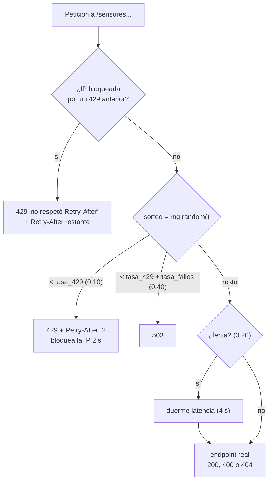

# AR-001 · Análisis: Open-Meteo y servicio inestable

| Campo | Valor |
|---|---|
| ID | AR-001 |
| Tipo | Análisis (paso 3 de SPDD) |
| Estado | Exploración hecha; **falta la revisión del equipo** antes de pasar al canvas |
| Fecha | 2026-10-17; sección 4 y hallazgos C5–C7 agregados el 2026-10-23 (rondas 5 y 7) |
| Historia | [AR-001 Story](../../requirements/AR-001-202610171311-[Story]-agregador-resiliente.md) |

Las secciones 1 a 3 salen de peticiones reales con `curl` (17 de octubre de 2026), de
leer `servicio_inestable.py` y, para la sección 3, de correrlo en un contenedor. Nada
está supuesto. Los hallazgos S1–S8 salen de leer el código; los C1–C7, de ejecutarlo.
La sección 4 es distinta: es una **simulación** (hallazgos M1–M6), y lo que dice hay
que validarlo con el servicio real cuando exista el código.

## Palabras clave del dominio

ciudad · candidato · geocodificación · pronóstico · clima actual · día · sensor ·
lectura · página · cursor · alerta · clave de idempotencia · reintento · espera ·
compuerta · caché · TTL · dependencia

## 1. Open-Meteo

Dos servicios distintos, ninguno pide clave:

| Uso | URL base | Endpoint |
|---|---|---|
| Buscar ciudad por nombre | `https://geocoding-api.open-meteo.com` | `/v1/search?name=&count=&language=es&countryCode=` |
| Traer ciudad por id | `https://geocoding-api.open-meteo.com` | `/v1/get?id=&language=es` |
| Pronóstico | `https://api.open-meteo.com` | `/v1/forecast?latitude=&longitude=&current=&daily=&timezone=auto&forecast_days=` |

### Lo que encontramos (y cómo afecta el diseño)

| # | Comportamiento real | Consecuencia para nosotros |
|---|---|---|
| E1 | Ciudad inexistente → **HTTP 200** con `{"generationtime_ms": …}` y **sin** el campo `results` | El modelo debe tratar `results` como opcional. Nosotros decidimos qué responder (P10). |
| E2 | Nombre de 1 letra → 200 vacío | Validar `min_length=2` y responder 422 sin llamar a Open-Meteo. |
| E3 | Nombres ambiguos: «Bucaramanga» trae 3 (Santander, Cundinamarca, Córdoba); «San José» trae 10 y el primero es California | Origen de D05: devolver candidatos con país y departamento. |
| E4 | `countryCode=CO` filtra bien (San José → solo Colombia) | Parámetro `pais` opcional en la búsqueda. |
| E5 | `get?id=3688465` devuelve la misma ficha que la búsqueda | Permite `GET /v1/ciudades/{id}/clima` (D07) con dos llamadas distintas. |
| E6 | `get?id` inexistente → **HTTP 400** `{"error":true,"reason":"Location ID not found."}` | **No** reintentar y traducir a **404**. Ojo: no todo 400 de Open-Meteo es «no existe». |
| E7 | El pronóstico diario viene en **listas paralelas** (`daily.time[]`, `daily.temperature_2m_max[]`, …) | Hay que juntarlas por día; validar que tengan el mismo largo. |
| E8 | Errores de validación → 400 con `{"error": true, "reason": "…"}` (latitud fuera de rango, variable inexistente, días > 16) | Validar nosotros primero (422) para no gastar llamadas. |
| E9 | `forecast_days` permite 0–16. Con 20 el mensaje dice «Given 16» (bug de ellos) | No confiar en el texto de `reason`; validar el rango nosotros. |
| E10 | **No** manda cabeceras de caché ni de límite de peticiones | El TTL lo fijamos nosotros (P02). |
| E11 | `current.interval` = 900 s: el dato actual se refresca cada 15 min | Un TTL de pronóstico por encima de 15 min entrega datos viejos. |
| E12 | `weather_code` es código WMO (p. ej. 51 = llovizna) | Para el dashboard hace falta una tabla de códigos → texto. |
| E13 | Toda la sala sale por la misma IP pública (dice el enunciado) | La caché reduce la carga compartida; los límites de Open-Meteo se reparten entre grupos. |

### Muestra real (Bucaramanga, recortada)

```json
{
  "timezone": "America/Bogota",
  "current": {"time": "2026-10-17T12:15", "interval": 900,
              "temperature_2m": 26.9, "relative_humidity_2m": 61,
              "weather_code": 51, "wind_speed_10m": 6.7},
  "daily": {"time": ["2026-10-17", "2026-10-18", "2026-10-19"],
            "temperature_2m_max": [27.4, 26.1, 27.7],
            "temperature_2m_min": [20.5, 20.3, 20.1],
            "precipitation_probability_max": [95, 88, 76]}
}
```

## 2. Servicio inestable (`servicio_inestable.py`)

### Endpoints

| Ruta | Falla a propósito | Notas |
|---|---|---|
| `GET /salud`, `GET /config` | No | El middleware solo inyecta fallos en rutas que empiezan por `/sensores`. |
| `GET /sensores?cursor=` | Sí | 23 sensores, 5 por página → 5 páginas; `siguiente` es `null` en la última. Cursor opaco (base64 de `o:{desplazamiento}`); cursor inválido → 400. |
| `GET /sensores/{id}/lectura` | Sí | Sensor inexistente → 404. |

### Orden en que decide cada petición a `/sensores…`



### Lo que encontramos al leer el código

| # | Hallazgo | Consecuencia para nosotros |
|---|---|---|
| S1 | El bloqueo tras un 429 es **por IP**, y se revisa **antes** del sorteo | Cualquier llamada que salga antes de vencer el Retry-After queda en el log como «no respetó». Con concurrencia, todas las llamadas en vuelo deben esperar juntas: origen de la compuerta (D14). |
| S2 | El sorteo de fallos ocurre **antes** de validar el sensor | Un sensor inexistente puede responder 503/429 antes de dar su 404. Reintentar el 503 está bien; el 404 que llega después se respeta. |
| S3 | La lentitud duerme **antes** de responder; si nosotros cortamos por timeout, el servidor igual termina y registra el código después | En la evidencia puede aparecer «lenta» y luego «200» aunque nosotros ya hayamos reintentado. Hay que explicarlo al presentar los logs. |
| S4 | Con valores por defecto: 10 % de 429, 30 % de 503 y 60 % de éxito (de esos, 20 % lentos) | Sin contar timeouts, cada llamada necesita en promedio 1/0,6 ≈ 1,7 intentos. `GET /v1/sensores` hace al menos 5 páginas + 23 lecturas = 28 llamadas, unos 47 intentos en promedio. Si el primer timeout (3 s, D13) corta las lentas, el éxito del primer intento baja a 0,6 × 0,8 = 48 %. |
| S5 | `--semilla` fija la **secuencia** de sorteos de todo el servicio, no la de cada petición | Con concurrencia, el orden de llegada cambia quién recibe cada fallo; la reproducibilidad es parcial. |
| S6 | Los valores de las lecturas usan `random.uniform` global, no la semilla | Los valores no se repiten entre corridas aunque se use `--semilla`. |
| S7 | El docente puede arrancarlo con otros parámetros (el ejemplo del enunciado usa `--latencia 5`) | Timeouts, intentos y esperas deben ser configurables por variables de entorno. |
| S8 | El servicio imprime una línea por petición con hora en milisegundos (`flush=True`) | Ese log sirve como evidencia de intentos, esperas y respeto de Retry-After. |

## 3. El servicio inestable dentro de Docker (D16)

Verificado el 2026-10-17 corriendo `servicio_inestable.py` sin modificar en un
contenedor `python:3.12-slim` (Docker 29.7.2), con una instancia en el host por
defecto y otra con `--host 0.0.0.0`. C5–C7 se verificaron el 2026-10-23 con Docker
29.9.1, Compose 5.6.0 y `python:3.12.15-slim-trixie`, en un Compose de prueba que no
está en el repo.

| # | Hallazgo | Consecuencia para nosotros |
|---|---|---|
| C1 | Con el host por defecto (`127.0.0.1`) el servicio responde **solo desde dentro** del contenedor; desde la máquina, `curl` falla con la conexión cortada (exit 56) | En Compose hay que arrancarlo con `--host 0.0.0.0`. Es un parámetro, así que no se modifica el archivo (S3). |
| C2 | `docker logs` sale **vacío** al arrancar: los dos `print` del inicio no usan `flush` y quedan en el buffer de Python. Las líneas por petición sí salen, porque usan `flush=True` | `PYTHONUNBUFFERED=1` en los contenedores (D29), o el mensaje de arranque no aparece en la evidencia. |
| C3 | Las peticiones que llegan a través de Docker aparecen con **una sola IP** (`172.17.0.1`, el gateway de Docker) | El bloqueo por IP tras un 429 sigue aplicando igual: la compuerta de D14 es necesaria también con Docker. |
| C4 | `docker stop` tarda 0,5 s y sale con código 0: uvicorn maneja SIGTERM aunque sea el PID 1 | No se repite el problema del taller de Docker, donde `http.server` ignoraba SIGTERM y Docker lo mataba a los 10 s. Hay que comprobarlo también con el agregador. |
| C5 | Los parámetros del servicio se pueden pasar desde Compose con variables interpoladas en `command` (`"${TASA_FALLOS:-0.30}"`): con `TASA_FALLOS=0.4 LATENCIA=5 docker compose up`, `/config` devolvió 0.4 y 5.0 | El docente cambia los parámetros sin editar archivos (D28). |
| C6 | Desde un contenedor que no está en el Compose, `host.docker.internal` **no resuelve** en Linux («Name or service not known»). Con `--add-host host.docker.internal:host-gateway` sí llega a la instancia publicada en el puerto 9000 de la máquina, y las peticiones aparecen con la IP del gateway (`172.18.0.1`) | El Compose del agregador lleva `extra_hosts` (D30). La IP única sigue haciendo necesaria la compuerta (C3). |
| C7 | Un healthcheck con `python -c "import urllib.request; urllib.request.urlopen('…/salud', timeout=2)"` funciona en la imagen slim, y `docker compose up --wait` vuelve cuando el servicio está sano. Los chequeos **no** aparecen en el log del servicio, que solo registra las rutas `/sensores` | Los healthchecks no ensucian la evidencia de reintentos (D31). Con `PYTHONUNBUFFERED=1` sí salen los mensajes de arranque (C2). |

## 4. Simulación de los reintentos (ronda 5)

Esta sección **no** sale de peticiones reales: es un modelo. Se hizo el 2026-10-23
para decidir P08 con números, porque el máximo de intentos y el plazo cambian mucho
qué tan completa sale `GET /v1/sensores`. El script es
[`simulacion_reintentos.py`](simulacion_reintentos.py) y corre en un contenedor (D16):

```bash
docker run --rm -v "$PWD":/app:ro -w /app python:3.12-slim \
  python spdd/analysis/simulacion_reintentos.py
```

*Qué modela:* el sorteo del servicio (S4), el bloqueo por IP tras un 429 (S1), las
respuestas lentas que duermen antes de responder (S3) y, de nuestro lado, el diseño de
D12 a D14: páginas en serie, 4 lecturas a la vez, compuerta compartida, jitter
completo, timeout por intento y plazo por petición. *Qué no modela:* la red (supone
20 ms por respuesta normal) ni Open-Meteo. Cada fila son 4000 peticiones con semilla
fija, contra dos configuraciones del servicio:

- **defecto:** 429 10 %, 503 30 %, lenta 20 % con 4 s;
- **enunciado:** `--tasa-fallos 0.4 --latencia 5` (el ejemplo del enunciado).

«Completa» son los 23 sensores con lectura; «Lista completa», las 5 páginas; «Sin
datos», ni un sensor con lectura, que es el caso que responde 502/504 (D21).
«Intentos» es el promedio de peticiones que recibe el servicio por cada
`GET /v1/sensores`.

**Tabla 1 · P08: intentos por llamada** (timeouts 3 → 6 → 8 s, sin plazo)

| Intentos | Servicio | Completa | Lista completa | Sin datos | Mediana | p95 | Máx. | Intentos |
|---|---|---|---|---|---|---|---|---|
| 3 | defecto | 8,9 % | 64,2 % | 8,4 % | 16 s | 28 s | 48 s | 39 |
| 3 | enunciado | 0,9 % | 44,0 % | 15,7 % | 16 s | 30 s | 50 s | 35 |
| 4 | defecto | 39,0 % | 84,6 % | 3,4 % | 19 s | 31 s | 54 s | 46 |
| 4 | enunciado | 11,8 % | 69,0 % | 7,6 % | 21 s | 35 s | 48 s | 47 |
| 5 | defecto | 68,1 % | 93,8 % | 1,0 % | 21 s | 34 s | 51 s | 50 |
| 5 | enunciado | 34,4 % | 80,8 % | 4,3 % | 25 s | 39 s | 58 s | 53 |
| 6 | defecto | 85,0 % | 97,5 % | 0,5 % | 22 s | 36 s | 54 s | 51 |
| 6 | enunciado | 58,8 % | 91,2 % | 1,7 % | 27 s | 43 s | 63 s | 58 |

**Tabla 2 · P08: plazo por petición** (6 intentos, timeouts 3 → 6 → 8 s)

| Plazo | Servicio | Completa | Lista completa | Sin datos | Mediana | p95 | Máx. | Intentos |
|---|---|---|---|---|---|---|---|---|
| sin plazo | defecto | 85,0 % | 97,5 % | 0,5 % | 22 s | 36 s | 54 s | 51 |
| sin plazo | enunciado | 58,8 % | 91,2 % | 1,7 % | 27 s | 43 s | 63 s | 58 |
| 30 s | defecto | 73,4 % | 97,7 % | 0,5 % | 22 s | 30 s | 30 s | 50 |
| 30 s | enunciado | 39,4 % | 90,2 % | 2,2 % | 27 s | 30 s | 30 s | 54 |
| 45 s | defecto | 84,8 % | 97,4 % | 0,5 % | 22 s | 35 s | 45 s | 51 |
| 45 s | enunciado | 58,1 % | 90,9 % | 1,9 % | 27 s | 43 s | 45 s | 57 |

**Tabla 3 · D13: timeouts por intento** (6 intentos, plazo 45 s)

| Timeouts | Servicio | Completa | Lista completa | Sin datos | Mediana | p95 | Máx. | Intentos |
|---|---|---|---|---|---|---|---|---|
| 3 → 5 → 8 s | defecto | 84,8 % | 97,4 % | 0,5 % | 22 s | 35 s | 45 s | 51 |
| 3 → 5 → 8 s | enunciado | 48,4 % | 90,0 % | 1,7 % | 30 s | 45 s | 45 s | 60 |
| 3 → 6 → 8 s | defecto | 84,8 % | 97,4 % | 0,5 % | 22 s | 35 s | 45 s | 51 |
| 3 → 6 → 8 s | enunciado | 58,1 % | 90,9 % | 1,9 % | 27 s | 43 s | 45 s | 57 |
| 6 → 8 → 8 s | defecto | 89,2 % | 98,0 % | 0,3 % | 21 s | 32 s | 45 s | 46 |
| 6 → 8 → 8 s | enunciado | 64,1 % | 92,6 % | 1,5 % | 27 s | 41 s | 45 s | 53 |

### Lo que encontramos (y cómo afecta el diseño)

| # | Hallazgo | Consecuencia para nosotros |
|---|---|---|
| M1 | Con 3 intentos solo sale completa el 8,9 % (defecto) o el 0,9 % (enunciado) de las respuestas. Una respuesta completa necesita 28 llamadas, y basta con que una se quede sin intentos | 6 intentos por llamada al servicio inestable (D17) |
| M2 | Las páginas son el eslabón débil: van en serie y, si una se pierde, se pierden las siguientes, porque su cursor no llega | La lista completa pasa del 64 % con 3 intentos al 97,5 % con 6 |
| M3 | Un plazo de 45 s casi no cambia la completitud frente a no tener plazo y acota el peor caso. Con 30 s, en el enunciado, las completas bajan del 58 % al 39 % | Plazo de 45 s por petición en `/v1/sensores` (D18) |
| M4 | Con `--latencia 5`, el timeout de 5 s del segundo intento también corta las respuestas lentas, aunque D13 decía que las toleraba: 48 % de completas con 3 → 5 → 8 s, frente a 58 % con 3 → 6 → 8 s | El segundo timeout pasa a 6 s (D19) |
| M5 | Sin el corte rápido (6 → 8 → 8 s) se completa algo más, pero con latencias de 4 o 5 s no habría ni un timeout y la evidencia nunca mostraría que los manejamos | El primer intento sigue en 3 s (D19) |
| M6 | Aun con 6 intentos y 45 s, con el enunciado 4 de cada 10 respuestas salen incompletas y la mediana es de 27 s | El dashboard debe mostrar `completo: false` y no puede esperar que sensores responda rápido |

## 5. Casos borde que van al canvas (Safeguards)

1. Nunca reintentar 400 ni 404, ni siquiera los 400 de Open-Meteo.
2. Nunca llamar al servicio inestable antes de que venza un Retry-After recibido.
3. Nunca devolver un 500 genérico: errores de las dependencias → 502 o 504 (D20).
4. Validar los parámetros propios (422) antes de gastar una llamada externa.
5. Toda llamada saliente lleva un timeout explícito.
6. Un recorrido de paginación termina siempre (cursor `null` o error), sin bucles.
7. Todo lo que se ejecute corre en contenedores (D16), y el agregador termina limpio
   con `docker stop` (C4).
8. Ninguna petición propia pasa de su plazo: ni un intento ni una espera se extienden
   más allá de la fecha límite (D18).
9. Una `Idempotency-Key` ya usada nunca crea una segunda alerta (D25).

## 6. Preguntas abiertas que salieron del análisis

En la ronda 5 se cerraron P08 (D17 y D18), P09 (D21), P11 (D22) y P12 (D20), y en
la 6, P20 (D23). En la 7 se cerraron P16–P19 y P21, cómo se arma Docker (D27–D31).
Siguen en la tabla de [decisiones pendientes](../../README.md#decisiones-pendientes)
del README: P02 (TTL) y P10 (búsqueda vacía).
