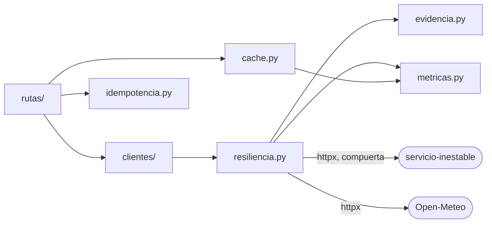

# AR-001 · Canvas REASONS: backend del agregador

| Campo | Valor |
|---|---|
| ID | AR-001 |
| Historia | [AR-001 Story](../../requirements/AR-001-202610171311-[Story]-agregador-resiliente.md) |
| Análisis | [AR-001 Analysis](../analysis/AR-001-202610171311-[Analysis]-open-meteo-y-servicio-inestable.md) |
| Enunciado | [requirements/enunciado/](../../requirements/enunciado/enunciado.md) |
| Decisiones | [Log D01–D41 del README](../../README.md#log-de-decisiones) |
| Estado | revisado por el equipo |
| Revisado por | Javier, al fusionar el PR #6 (2026-10-23) |
| Fecha | 2026-10-23 |

Este canvas es la fuente de verdad del comportamiento del backend. Si el código y el
canvas no coinciden, **se corrige primero el canvas** y después el código (D02). Cada
afirmación cita la decisión de la que sale; lo que no sale de ninguna está en la
sección «Detalles que fija este canvas», para revisarlo junto con el resto.

Fuera de alcance: el dashboard (D08, D10), que va al final y tendrá su propio canvas,
y la Parte E, que no se hace (D43).

## R · Requirements (requisitos)

Una API propia en FastAPI que consume Open-Meteo (D01) y el servicio inestable del
docente, y que sigue respondiendo bien aunque fallen. Todo corre en Docker (D16, D23).

| Ruta | Éxito | Errores | Decisiones |
|---|---|---|---|
| `GET /v1/ciudades?nombre=&pais=` | 200 con la lista de candidatos; lista vacía si no hay | 422 si `nombre` tiene menos de 2 caracteres o `pais` no es ISO-2; 502/504 si falla Open-Meteo | D05, D07, D36, D20 |
| `GET /v1/ciudades/{id}/clima?dias=` | 200 con la ciudad, el clima actual y los días | 404 si el id no existe; 422 si `dias` no está entre 1 y 16; 502 si Open-Meteo responde algo que no cumple el modelo; 502/504 si falla | D07, D20, E6–E9 |
| `GET /v1/sensores` | 200 con los sensores y sus lecturas; `completo: false` y `motivo` si falta algo | 502/504 si no obtuvo ningún sensor o ninguna lectura | D15, D21, D20 |
| `POST /v1/alertas` | 201 con `Location`; la misma respuesta si se repite la clave con el mismo cuerpo | 400 sin `Idempotency-Key`; 422 con la misma clave y otro cuerpo, o si el cuerpo no es válido; 409 si la primera sigue en curso | D24, D25 |
| `GET /v1/alertas` · `GET /v1/alertas/{id}` | 200 | 404 si la alerta no existe | D24 |
| `GET /v1/metricas` | 200 con los contadores | — | D35 |
| `GET /salud` | 200 `{"estado": "ok"}`, sin consultar dependencias | — | HU5, D31 |

Comportamiento transversal:

- Las rutas de ciudades usan la caché (D32). `Cache-Control: no-cache` se la salta, y la
  respuesta lleva `Cache-Status` (D33).
- Toda llamada saliente pasa por los reintentos de `llamar_con_reintentos` (D12,
  D17–D22) y deja una línea de evidencia por intento (D37).
- Ninguna petición pasa de su plazo: 45 s en sensores y 15 s en Open-Meteo (D18).

**Terminado** cuando se cumple la definición de terminado de la historia, incluida la
colección de pruebas en verde con `docker compose run --rm pruebas` (D26, D28), y la
sección «D12 en detalle» del README describe el código real (regla 4 de AGENTS.md).

## E · Entities (entidades)

Modelos Pydantic de la API propia (`agregador/modelos.py`):

| Modelo | Campos |
|---|---|
| `Ciudad` | `id`, `nombre`, `departamento`, `pais`, `codigo_pais`, `latitud`, `longitud`, `poblacion` (los tres de país y región y la población pueden faltar) |
| `ClimaActual` | `hora`, `temperatura_c`, `humedad_pct`, `codigo_tiempo` (WMO, E12), `viento_kmh` |
| `DiaPronostico` | `fecha`, `maxima_c`, `minima_c`, `prob_lluvia_pct` |
| `RespuestaClima` | `ciudad: Ciudad`, `zona_horaria`, `actual: ClimaActual`, `dias: list[DiaPronostico]` |
| `Lectura` | `valor`, `unidad`, `marca_tiempo` |
| `SensorConLectura` | `id`, `tipo`, `ubicacion`, `lectura: Lectura \| None`, `motivo: str \| None` |
| `RespuestaSensores` | `sensores: list[SensorConLectura]`, `completo: bool`, `motivo: str \| None` |
| `NuevaAlerta` | `objetivo: {tipo: "ciudad" \| "sensor", id}`, `variable`, `condicion: "mayor_que" \| "menor_que"`, `umbral: float` |
| `Alerta` | `NuevaAlerta` + `id` + `creada` (UTC) |
| `CuerpoErrorDependencia` | `detalle`, `dependencia: "open_meteo" \| "servicio_inestable"`, `causa`, `intentos` (cuerpo de 502/504, D20) |
| `Metricas` | `desde`; por dependencia: `llamadas`, `intentos`, `reintentos`, `por_resultado`, `respuestas_502`, `respuestas_504` y, en el servicio inestable, `compuerta_cerrada_hasta`; `cache` (`aciertos`, `fallos`); `latencia_ms` por plantilla de ruta (`peticiones`, `mediana`, `p95`) (D35) |

Modelos de las respuestas externas, para validar lo que llega (HU2: datos inválidos →
502, no datos a medias):

- **Open-Meteo:** búsqueda con `results` opcional (E1); ficha por id; pronóstico con
  `current` y `daily` en listas paralelas, que se validan con el mismo largo antes de
  juntarlas por día (E7).
- **Servicio inestable:** página `{sensores: [{id, tipo, ubicacion}], siguiente: str | None}`
  y lectura `{sensor_id, tipo, valor, unidad, marca_tiempo}`.

En memoria, sin persistencia (D24, D25, D32, D35): alertas, claves de idempotencia,
cachés y métricas. Se pierden al reiniciar el contenedor.

## A · Approach (enfoque)

1. **Reintentos a mano en un solo módulo** (D12): las ocho funciones de «D12 en
   detalle» del README, con las reglas de D17–D22: 6 intentos hacia el servicio
   inestable y 3 hacia Open-Meteo; timeouts 3 → 6 → 8 s; jitter completo; Retry-After
   respetado; compuerta compartida y turno de envío solo para el servicio inestable
   (D14, D42); plazo por petición; 502/504 al rendirse.
2. **Fecha límite por petición** (D18): la fija cada ruta al recibir la petición y la
   pasa a todas sus llamadas salientes.
3. **Concurrencia con asyncio** (D14): un `httpx.AsyncClient` por dependencia, creado
   en el `lifespan` de FastAPI y cerrado al apagar; las lecturas van con un semáforo
   de 4, pero salen de a una por el turno de envío (D42).
4. **Fallo parcial** (D15, D21): `GET /v1/sensores` devuelve lo obtenido con
   `completo: false`; con cero sensores o cero lecturas, 502/504.
5. **Caché a mano** (D32, D33): diccionario + `time.monotonic()`; `Cache-Status`
   según la RFC 9211.
6. **Idempotencia** (D25): almacén en memoria con la huella SHA-256 del cuerpo
   validado y un candado por clave, que es lo que permite responder 409 si la primera
   petición sigue en curso.
7. **Evidencia y métricas en el mismo lugar** (D35, D37): cada intento escribe su
   línea y suma a los contadores; un middleware asigna el id de la petición y escribe
   la línea final.

## S · Structure (estructura)

```text
agregador/
  main.py             app de FastAPI, lifespan, middleware de evidencia, /salud y manejadores de error
  config.py           configuración desde variables de entorno (ver Norms)
  modelos.py          modelos Pydantic (Entities)
  resiliencia.py      D12: es_reintentable … llamar_con_reintentos, Politica, CompuertaRetryAfter, ErrorDependencia
  evidencia.py        D37: id de petición y formato de las líneas del log
  metricas.py         D35: RegistroMetricas, los contadores
  cache.py            D32, D33: CacheTTL y Cache-Status
  idempotencia.py     D25
  clientes/
    open_meteo.py     buscar, obtener_ciudad, pronosticar
    sensores.py       recorrer_paginas, leer_lecturas
  rutas/
    ciudades.py  sensores.py  alertas.py  metricas.py
pruebas/
  test_resiliencia.py   unitarias, con httpx.MockTransport
  test_sensores.py      la ruta de sensores con un servicio falso
  test_api_*.py         contra el stack levantado (D26)
  medir_latencia.py     D34
  medir_sensores.py     tarea 9: /v1/sensores contra el servicio real
Dockerfile  docker-compose.yml  requirements.txt  .dockerignore  pytest.ini
```



Docker (D28–D31): una imagen para `agregador`, `servicio-inestable` y `pruebas` (este
último bajo el perfil `pruebas`); healthchecks en Python; el agregador no espera al
servicio inestable; `extra_hosts` con `host-gateway`.

## O · Operations (operaciones)

Cada tarea es un PR (`feat/…`), dice qué toca y cómo se comprueba, y quién la hace
según D40. Las tareas 1–4 son la base común; sin ellas no corre nada.

| # | Tarea | Archivos | Cómo se comprueba | Rol |
|---|---|---|---|---|
| 1 | Imagen y dependencias (D29) | `requirements.txt`, `Dockerfile`, `.dockerignore` | `docker build`; la imagen corre como usuario no root y tiene las versiones fijadas | Javier |
| 2 | Esqueleto, configuración y Compose (D28, D30, D31) | `agregador/main.py`, `config.py`, `docker-compose.yml` | `docker compose up --wait` deja los dos servicios sanos; `/salud` responde 200; `TASA_FALLOS=0.4` llega a `/config` (C5); `docker stop` termina en menos de 1 s (C4) | Javier |
| 3 | Evidencia (D37) | `agregador/evidencia.py`, middleware en `main.py` | Cada petición deja su línea final en `docker compose logs agregador`; `/salud` no deja ninguna | Javier |
| 4 | Métricas (D35) | `agregador/metricas.py`, `rutas/metricas.py` | `GET /v1/metricas` responde con todos los contadores en cero | Javier |
| 5 | Funciones puras de reintento (D12, D19, D22) | `agregador/resiliencia.py`, `pruebas/test_resiliencia.py` | Pruebas unitarias de `es_reintentable`, `leer_retry_after` (segundos, fecha e inválido), `calcular_espera` y `timeout_para` | Javier |
| 6 | Compuerta y `llamar_con_reintentos` (D12, D17, D18, D20) | `agregador/resiliencia.py`, `pruebas/test_resiliencia.py` | Con `MockTransport`: 503 → 200; 429 con Retry-After respetado; 404 sin reintento; conexión caída reintentada; timeouts → 504; plazo agotado → 504; 503 agotados → 502; la compuerta frena a todas las llamadas en vuelo | Javier |
| 7 | Sensores (D14, D15, D21) | `clientes/sensores.py`, `rutas/sensores.py` | Contra el servicio real: el log muestra intentos, esperas y Retry-After respetados; nunca aparece «no respetó Retry-After» en el log del servicio | Javier |
| 8 | Colección: sensores, salud y métricas (D26) | `pruebas/test_api_sensores.py` | `docker compose run --rm pruebas` en verde con los parámetros por defecto y con `TASA_FALLOS=0.4 LATENCIA=5` | Javier |
| 9 | Validar la simulación | sección 4 del análisis | 50 peticiones a `/v1/sensores` por configuración; completitud y mediana comparadas con las tablas del modelo. Si no coinciden, se corrige primero el canvas | Javier |
| 10 | Cliente de Open-Meteo (D22) | `clientes/open_meteo.py`, modelos externos | Búsqueda, ficha y pronóstico con 3 intentos y sin compuerta; `results` ausente → lista vacía (E1); id inexistente → 404 sin reintento (E6) | Maria Fernanda |
| 11 | Caché (D32, D33) | `agregador/cache.py` | Pruebas unitarias de vencimiento, `no-cache` y los cuatro valores de `Cache-Status` | Maria Fernanda |
| 12 | Rutas de ciudades (D05, D07, D36) | `rutas/ciudades.py` | Los criterios de HU1 y HU2, incluidos los 422 antes de llamar a Open-Meteo (E2, E8) | Maria Fernanda |
| 13 | Alertas e idempotencia (D24, D25) | `agregador/idempotencia.py`, `rutas/alertas.py` | 400, 201 repetido, 422 y 409 de D25; `Location` apunta a la alerta | Maria Fernanda |
| 14 | Colección: ciudades y alertas, y latencia (D26, D34) | `pruebas/test_api_ciudades.py`, `test_api_alertas.py`, `medir_latencia.py` | `docker compose run --rm pruebas` en verde; la tabla de latencias va al README | Maria Fernanda |
| 15 | README de entrega | `README.md` | Definición de terminado: cómo arrancar (D28, D30), latencias, idempotencia, respuestas a–d de la Parte D y evidencias | Maria Fernanda |

La tarea 10 necesita la 6 (usa `llamar_con_reintentos`); las tareas 11 y 13 pueden
empezar después de la 4.

## N · Norms (normas)

- **Idioma:** español en rutas, campos, mensajes, identificadores, comentarios y
  commits (S1). La instancia de FastAPI se llama `app`, como en el archivo del docente.
- **Configuración:** solo por variables de entorno, todas con valor por defecto:

  | Variable | Por defecto | Decisión |
  |---|---|---|
  | `SERVICIO_INESTABLE_URL` | `http://servicio-inestable:9000` | D30 |
  | `OPEN_METEO_GEOCODING_URL` · `OPEN_METEO_FORECAST_URL` | `https://geocoding-api.open-meteo.com` · `https://api.open-meteo.com` | D01 |
  | `MAXIMO_INTENTOS_SENSORES` · `MAXIMO_INTENTOS_OPEN_METEO` | `6` · `3` | D17, D22 |
  | `PLAZO_SENSORES_S` · `PLAZO_OPEN_METEO_S` | `45` · `15` | D18 |
  | `TIMEOUTS_LECTURA_S` · `TIMEOUT_CONEXION_S` | `3,6,8` · `2` | D19 |
  | `BACKOFF_BASE_S` · `BACKOFF_TOPE_S` | `0.5` · `8` | D12 |
  | `CONCURRENCIA_LECTURAS` | `4` | D14 |
  | `VENTANA_ENVIO_S` | `0.25` | D42 |
  | `TTL_CIUDADES_S` · `TTL_PRONOSTICO_S` | `86400` · `900` | D32 |
  | `TTL_IDEMPOTENCIA_S` | `86400` | D25 |

- **Errores:** los 422 de validación son los de FastAPI; los fallos de dependencias
  responden con `ErrorDependencia` (D20). Un error de una dependencia nunca sale como 500.
- **Log:** el formato de D37, por stdout, en UTC; una línea por intento y una final
  por petición. `/salud` no escribe líneas, para no tapar la evidencia (C7).
- **Código:** con anotaciones de tipos y Pydantic v2. Los comentarios explican el
  porqué y citan la D de la que sale el comportamiento, para que «D12 en detalle» y el
  código se puedan leer lado a lado.
- **Pruebas:** pytest. Las unitarias, con `httpx.MockTransport`, sin red. Las de la
  colección, contra el stack levantado, afirman invariantes (D26).
- **Git:** una rama `feat/…` y un PR por tarea o grupo de tareas, con Conventional
  Commits; nunca push directo a `main`.

## S · Safeguards (salvaguardas)

Las once del análisis (sección 5) más las del proceso:

1. Nunca reintentar 400 ni 404, ni siquiera los 400 de Open-Meteo.
2. Nunca llamar al servicio inestable antes de que venza un Retry-After recibido; toda
   llamada al servicio pasa por la compuerta y por el turno de envío (D42).
3. Nunca devolver un 500 por un error de una dependencia: 502 o 504 (D20).
4. Validar los parámetros propios (422) antes de gastar una llamada externa.
5. Toda llamada saliente lleva un timeout explícito.
6. Un recorrido de paginación termina siempre: cursor `null`, error o cursor repetido.
7. Todo corre en contenedores (D16, D23), y el agregador termina limpio con
   `docker stop` (C4).
8. Ninguna petición propia pasa de su plazo (D18).
9. Una `Idempotency-Key` ya usada nunca crea una segunda alerta (D25).
10. Una petición con `Cache-Control: no-cache` nunca se responde desde la caché (D33).
11. Los sensores nunca se cachean (D32).
12. El agregador arranca y responde `/salud` aunque el servicio inestable no esté (D31).
13. `servicio_inestable.py` no se modifica (S3).

## Detalles que fija este canvas (para revisar)

No salen de ninguna decisión; se fijan aquí para poder generar el código, y se
aprueban al revisar el canvas:

1. Paquete `agregador/`, pruebas en `pruebas/`, agregador en el puerto 8000.
2. `dias` vale 7 por defecto, como en Open-Meteo.
3. Ids de alerta secuenciales: `a-0001`, `a-0002`…
4. `variable` admite `temperatura`, `humedad`, `viento`, `prob_lluvia`, `ruido` y
   `co2`; no se comprueba que el objetivo exista, porque D24 deja el recurso sin
   dependencias externas.
5. La huella de idempotencia se calcula sobre el cuerpo ya validado
   (`model_dump(mode="json")`, con claves ordenadas), así `30` y `30.0` cuentan como el
   mismo cuerpo.
6. Valores de `causa` en `ErrorDependencia`: `timeout`, `plazo`, `503`, `429`,
   `conexion` y `respuesta_invalida`.
7. Identificadores de `Cache-Status`: `agregador-ciudades` y `agregador-pronostico`.
8. Llamadas a Open-Meteo: `language=es`; el pronóstico pide `temperature_2m`,
   `relative_humidity_2m`, `weather_code` y `wind_speed_10m` en `current`, y
   `temperature_2m_max`, `temperature_2m_min` y `precipitation_probability_max` en
   `daily`, con `timezone=auto`.
9. Id de petición en el log: `r-` y 4 caracteres hexadecimales al azar.
10. Las latencias de `GET /v1/metricas` usan las últimas 100 peticiones por ruta.

## Cambios

Lo que se cambió en este canvas después de revisarlo, y por qué (regla 3 de AGENTS.md).

| Fecha | Tareas | Cambio | Por qué |
|---|---|---|---|
| 2026-10-23 | 1–6 | El cuerpo de los 502/504 se llama `CuerpoErrorDependencia`; la clase de los contadores, `RegistroMetricas`; `resiliencia.py` agrega `Politica`; se fija la forma de `Metricas`, y se suma `pytest.ini` | Nombres al implementar, sin cambio de comportamiento: `ErrorDependencia` ya era la excepción y `Metricas` el modelo de la respuesta |
| 2026-10-23 | 10–15 | El «candado por clave» de la idempotencia (A6) es el registro de la clave en curso, sin `asyncio.Lock`; los valores diarios de `DiaPronostico` pueden ser `null`; `GET /v1/ciudades` responde la lista sin envoltorio; los modelos externos de Open-Meteo viven en `clientes/open_meteo.py`, y se suman `pruebas/conftest.py` y `pruebas/open_meteo_falso.py` | Sin cambio de comportamiento: en asyncio no hay `await` entre buscar la clave y registrarla, así que el registro ya excluye a la segunda petición y el 409 sale igual. Open-Meteo puede dejar un día en `null`, y rechazarlo daría un 502 por un dato que sí llegó |
| 2026-10-23 | 7–9 | Turno de envío en la compuerta (D42): Approach 1 y 3, Norms (`VENTANA_ENVIO_S`), Safeguard 2 y Structure (`test_sensores.py`, `medir_sensores.py`) | Cambio de comportamiento. Salió al probar contra el servicio real (hallazgo C8): la compuerta no alcanzaba a las peticiones que ya habían salido. Se probó en la rama para medirlo, y el equipo lo eligió con esos números antes de integrarlo |
